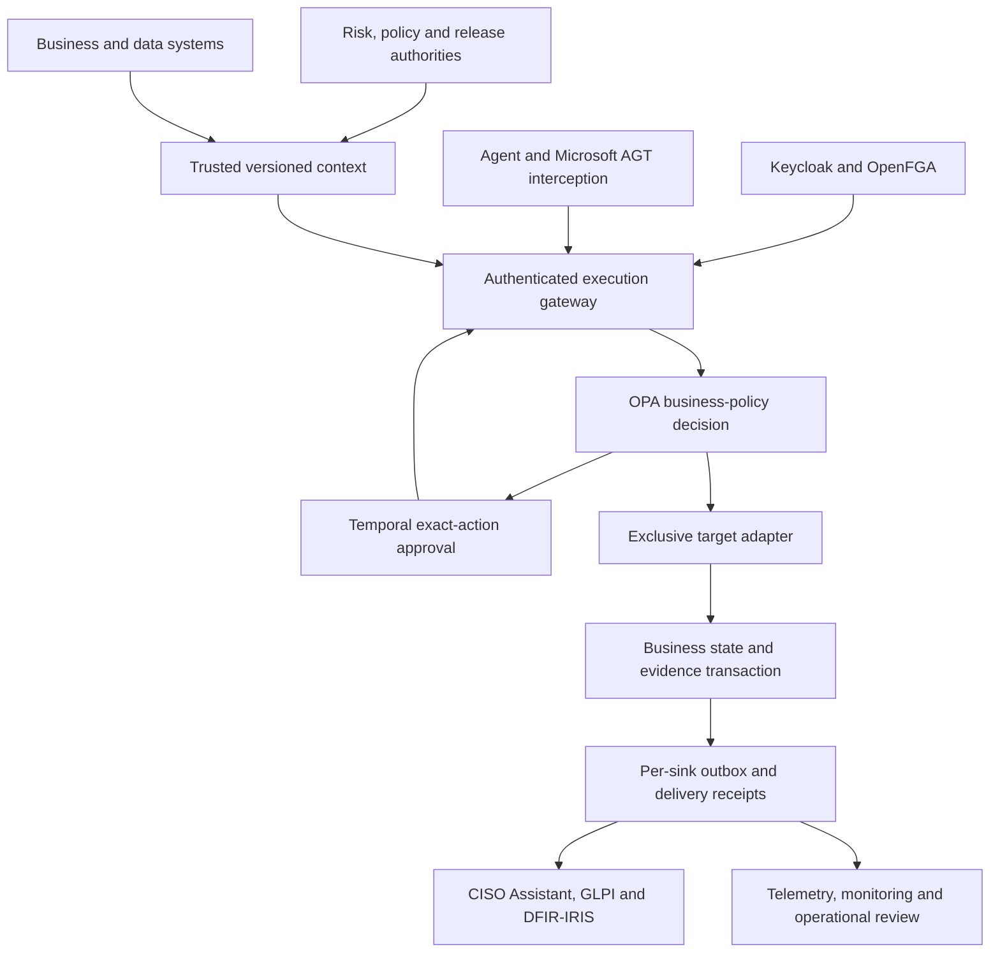

<p align="center"></p>

# Governed Agent Fabric

[](https://github.com/CodeDaim0n/AI-governance-repo/actions/workflows/ci.yml)
[](LICENSE)


**Connect governance decisions to the systems where agents act.**

An open-source reference implementation for regulated agentic workflows: risk records, identity, policies, approvals, data lineage, validation, execution controls, evidence and incident response connected through explicit interfaces.

[Quickstart](docs/getting-started.md) · [Architecture](docs/architecture.md) · [All 18 components](docs/components/catalogue.md) · [Full deployment](docs/deployment/full-stack.md) · [Research paper](docs/Governed_Agent_Fabric_Research_Paper.pdf) · [Validation evidence](docs/validation.md)

> **Project status:** research prototype. The original enforcement core has 51 observed checks. The expanded package contains code and deployment paths for all 18 component groups. **The complete native stack has not run in this environment**, which lacks Docker, Kubernetes and eBPF privileges. [Live status](results/all-18-live.json) records `BLOCKED`, not a fabricated pass. No production-readiness or regulatory-certification claim is made.

## Why this exists

An assessment report cannot enforce permissions, prevent an unauthorized write, reconcile a lost response or accept a risk on behalf of its owner. This project connects assessment records to authoritative enterprise systems and makes the write path enforce the resulting restrictions.

A synthetic credit process demonstrates the mechanics. It does not implement lending eligibility, affordability, AML, sanctions screening or validated credit underwriting.

## What the implementation connects

| Boundary | Component groups | Responsibility |
| --- | --- | --- |
| Identity and authority | Keycloak, OpenFGA, OPA, Microsoft AGT | Authenticate, scope access, evaluate business restrictions and intercept tool calls. |
| Governance records | CISO Assistant Community, GLPI, OpenMetadata, MLflow | Maintain risks, service/change records, data context and evaluated artifact versions. |
| Controlled execution | Temporal, PostgreSQL, OpenBao, Kubernetes/Cilium | Bind approvals, commit state/evidence, protect credentials and restrict the agent's network. |
| Operational assurance | OpenTelemetry, Prometheus/Alertmanager, DFIR-IRIS | Trace outcomes, alert on control failures and record investigation. |
| Model and release assurance | Fairlearn, Ollama/Qwen, Syft/Grype/Cosign | Exercise evaluation, generate bounded proposals and scan/sign release artifacts. |

These are **18 component groups**, not 18 containers. Several products require supporting databases or workers. The [component catalogue](docs/components/catalogue.md) gives the native interface, implementation file, acceptance operation and remaining evidence for each.

## Architecture at a glance



[Detailed component diagram](docs/architecture.svg) · [Execution sequence](docs/execution-flow.svg) · [Evidence graph](docs/evidence-graph.svg)

## Choose a starting point

| I want to… | Start here |
| --- | --- |
| Understand the boundaries and product choices | [Architecture guide](docs/architecture.md) |
| Run the observed, small enforcement laboratory | [Core quickstart](docs/getting-started.md#core-laboratory) |
| Deploy every native component | [Full-stack commissioning](docs/deployment/full-stack.md) |
| Inspect the code behind a particular product | [Component catalogue](docs/components/catalogue.md) |
| Read what passed and what remains unverified | [Validation and evidence](docs/validation.md) |
| Call the gateway or integrate a business system | [API reference](docs/api.md) |
| Operate or recover the deployment | [Operations runbook](docs/runbooks/operations.md) |
| Review assumptions and design tradeoffs | [Architecture decisions](docs/decisions/README.md) |
| Extend the implementation | [Contributing](CONTRIBUTING.md) and [developer guide](docs/development/contributing.md) |

## Run the core laboratory

Python 3.11+ and an official OPA binary are required. The fetch helper pins the exact historical binary used in the original experiment; it is not a recommendation to deploy that release in production.

```bash
git clone https://github.com/CodeDaim0n/AI-governance-repo.git
cd AI-governance-repo
python3 -m venv .venv
source .venv/bin/activate
python -m pip install -r requirements.txt
python scripts/fetch_opa.py
OPA_BIN="$PWD/.local/opa" python scripts/test_all.py
python scripts/assess.py
```

The native stack has a separate [dependency set](requirements-enterprise.txt) and [deployment sequence](docs/deployment/full-stack.md). Do not mistake a passing core test run for completion of the 18-component acceptance suite.

## Evidence and scope

| Evidence | Observed state |
| --- | --- |
| Original Python control and HTTP checks | 42 passed; [result](results/summary.json), [log](results/tests.log) |
| Original OPA policy checks | 6 passed; [log](results/rego-tests.log) |
| Original Microsoft AGT wrapper checks | 3 passed; [result](results/agt.json) |
| Expanded native adapter contracts | 26 passed using simulated HTTP; [log](results/native-contract-tests.log) |
| Isolated Fairlearn → MLflow HTTP path | Evaluation stored/read back; candidate remained unapproved; [result](results/local-native-evaluation.json) |
| Complete native-stack acceptance | [Machine-readable live status](results/all-18-live.json); not run successfully here |
| Production observation and independent validation | Not performed |

The paper explains which conclusions these results support, including the limits of self-authored tests. The live acceptance runner performs product operations and read-backs; a health endpoint alone never counts as a pass.

## Repository map

```text
fabric/             Core gateway and native product integrations
policies/           OPA policy and policy tests
scripts/            Reproduction, commissioning and acceptance commands
deploy/             Core, native Compose and Kubernetes/Cilium configuration
docs/               Architecture, component guides, API, runbooks and research
results/            Observed evidence and explicit blocked/unverified statuses
tests/              Core control tests and native adapter contract tests
```

## Security and governance

Risk acceptance remains with an authorized human owner. Runtime trust scores cannot expand delegated authority. Agents receive no direct target credentials. Production requires independent validation, scoped identities, TLS, target-side conditional writes, evidence retention and recovery drills.

Please follow [SECURITY.md](SECURITY.md) for reporting vulnerabilities. Never post customer data, credentials, tokens or sensitive traces in a public issue.

## Documentation and contribution

Build the searchable documentation locally with `mkdocs serve` after installing [requirements-docs.txt](requirements-docs.txt). GitHub renders the Markdown guides and Mermaid diagrams directly. No automatic documentation deployment or recurring bot jobs are enabled.

Contributions should include the relevant negative test and preserve the distinction between implemented, tested and observed controls. See [CONTRIBUTING.md](CONTRIBUTING.md), [the contribution checklist](docs/development/contributing.md) and [CHANGELOG.md](CHANGELOG.md).

## License and attribution

Project code and original documentation use the [MIT License](LICENSE). Integrated products retain their own licenses; Community and commercial editions are not interchangeable. [Product license baselines](docs/products.csv) and [primary research references](docs/references.json) are supplied. This independent project is not affiliated with or endorsed by Microsoft, NIST, OWASP or the named product maintainers.
