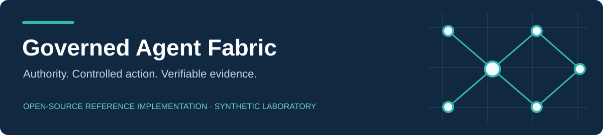
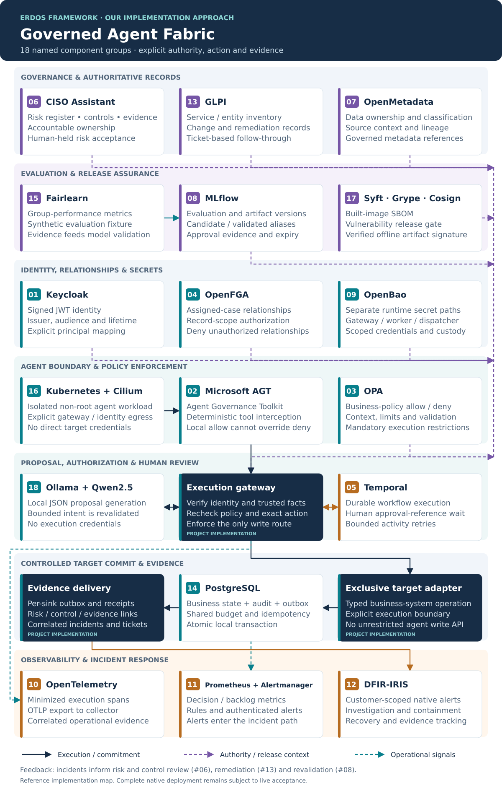
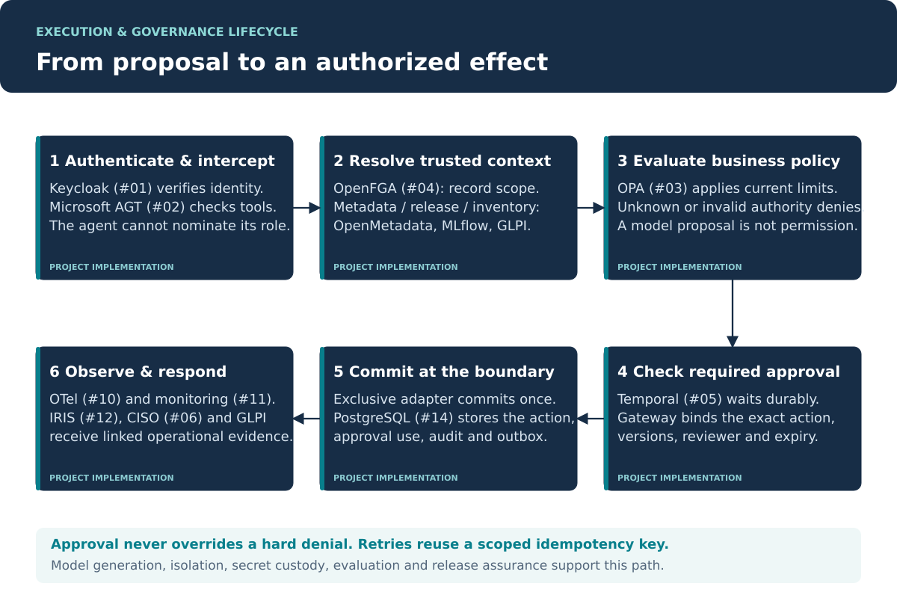

<p align="center"></p>

# Governed Agent Fabric

[](https://github.com/CodeDaim0n/AI-governance-repo/actions/workflows/ci.yml)
[](LICENSE)


**Connect governance decisions to the systems where agents act.**

Our implementation approach to the **[Erdos governance framework](https://www.linkedin.com/pulse/implementing-governance-agentic-workflows-erdos-effect-vipie)**, bringing together **18 open-source component groups** across governance, identity, policy, workflow, data, models, security and operations.

The suite covers the full lifecycle: governance and risk, identity and authorization, data and model assurance, controlled execution, operational evidence, and incident response. Native adapters, shared authority rules, exact-action approvals and linked evidence connect these capabilities across products.

**The architecture and integration model are domain-independent.** Business-specific rules and target operations belong in replaceable policies and adapters. The diagrams below show the generic suite and the path from an agent proposal to a governed business action.

[Quickstart](docs/getting-started.md) · [Architecture](docs/architecture.md) · [All 18 components](docs/components/catalogue.md) · [Full deployment](docs/deployment/full-stack.md) · [Research paper](docs/Governed_Agent_Fabric_Research_Paper.pdf) · [Validation evidence](docs/validation.md)

> **Status:** Research implementation. All 18 component groups have integration and deployment code; complete native-stack live validation is pending. [See the recorded evidence and deployment requirements](docs/validation.md).

## System architecture · all 18 components

Each numbered product has its own card and responsibility. Dark cards identify our gateway, target adapter and evidence-delivery code. The diagram separates governance records, validation, trust, execution and operations.



[Open the full-size architecture](docs/assets/system-architecture-18.svg) · [Component reference and implementation links](docs/components/catalogue.md)

## From proposal to an authorized effect



[Open the full-size execution flow](docs/assets/execution-governance-flow.svg) · [Detailed architecture guide](docs/architecture.md)

## Our implementation of the Erdos framework

We extended the Erdos governance framework into a practical implementation approach, connecting its workflow assessment inputs and outputs to open-source products, enterprise-system interfaces and execution controls. Our focus is making the framework concrete through explicit component responsibilities, linked evidence and a reproducible synthetic laboratory.

## The 18 products and platforms we brought together

Our implementation approach spans governance, identity, authorization, workflow orchestration, data and model assurance, secret custody, network isolation, observability, incident response and release security. Each numbered group below represents established open-source products or specialist tools with a distinct job in the architecture.

**Our engineering contribution is the composition:** defining their native interfaces, shared identifiers, authority boundaries, approval handoffs and evidence flows so they can support one governed workflow.

| Diagram ID | Product and official links | Its role in our implementation |
| --- | --- | --- |
| **01** | **[Keycloak](https://www.keycloak.org/)** | Identity and access management providing signed identities and access tokens for agents and reviewers. |
| **02** | **[Microsoft Agent Governance Toolkit](https://github.com/microsoft/agent-governance-toolkit)** | Runtime governance toolkit intercepting tool calls before they enter our centrally governed execution path. |
| **03** | **[Open Policy Agent (OPA)](https://www.openpolicyagent.org/)** | Policy engine evaluating deterministic allow/deny rules for actions, budgets, context and operational restrictions. |
| **04** | **[OpenFGA](https://openfga.dev/)** | Fine-grained authorization service deciding whether a particular agent may act on a particular record. |
| **05** | **[Temporal](https://temporal.io/)** | Durable workflow engine maintaining process progress, human approval waits and bounded retries. |
| **06** | **[CISO Assistant Community](https://github.com/intuitem/ciso-assistant-community)** | Governance, risk and compliance platform holding our risk register, control ownership, treatment and linked evidence. |
| **07** | **[OpenMetadata](https://open-metadata.org/)** | Metadata platform supplying data ownership, classification and lineage for trusted workflow context. |
| **08** | **[MLflow](https://mlflow.org/)** | Model lifecycle platform connecting versioned evaluation evidence, candidate artifacts and approved release records. |
| **09** | **[OpenBao](https://openbao.org/)** | Secrets-management platform separating credential access for the gateway, workflow worker and evidence dispatcher. |
| **10** | **[OpenTelemetry](https://opentelemetry.io/)** | Observability framework exporting minimized execution spans so decisions and outcomes can be traced. |
| **11** | **Prometheus + Alertmanager** — [Prometheus](https://prometheus.io/) · [Alertmanager](https://prometheus.io/docs/alerting/latest/alertmanager/) | Monitoring and alerting products turning decision, failure and delivery-backlog metrics into operational signals. |
| **12** | **[DFIR-IRIS](https://www.dfir-iris.org/)** | Incident-response platform receiving customer-scoped alerts and supporting investigation, containment and recovery. |
| **13** | **[GLPI](https://www.glpi-project.org/en/)** | IT service-management and asset platform linking workflows to owned services and trackable remediation tickets. |
| **14** | **[PostgreSQL](https://www.postgresql.org/)** | Transactional database coordinating business state, shared limits, approvals, audit records and delivery receipts. |
| **15** | **[Fairlearn](https://fairlearn.org/)** | Responsible-AI evaluation library calculating group-outcome differences and producing versioned validation evidence. |
| **16** | **Kubernetes + Cilium** — [Kubernetes](https://kubernetes.io/) · [Cilium](https://cilium.io/) | Workload and network-security platforms isolating the agent and restricting its permitted network routes. |
| **17** | **Syft + Grype + Cosign** — [Syft](https://github.com/anchore/syft) · [Grype](https://github.com/anchore/grype) · [Cosign](https://github.com/sigstore/cosign) | Software-supply-chain tools inventorying built images, checking vulnerabilities and signing/verifying release artifacts. |
| **18** | **Ollama + Qwen2.5** — [Ollama](https://ollama.com/) · [Qwen model](https://huggingface.co/Qwen/Qwen2.5-0.5B-Instruct) | Local model runtime and language model generating bounded JSON proposals before deterministic authorization. |

The numbers match the architecture diagram. These are 18 **component groups**, covering platforms, services, SDKs, evaluation libraries and security tools; several groups contain multiple products. [Explore each component’s implementation and evidence](docs/components/catalogue.md).

## Choose a starting point

| I want to… | Start here |
| --- | --- |
| Understand the boundaries and product choices | [Architecture guide](docs/architecture.md) |
| Run the observed, small enforcement laboratory | [Core quickstart](docs/getting-started.md#core-laboratory) |
| Deploy every native component | [Full-stack commissioning](docs/deployment/full-stack.md) |
| Inspect the code behind a particular product | [Component catalogue](docs/components/catalogue.md) |
| Read what passed and what remains unverified | [Validation and evidence](docs/validation.md) |
| Call the gateway or integrate a business system | [API reference](docs/api.md) |
| Operate or recover the deployment | [Operations runbook](docs/runbooks/operations.md) |
| Review assumptions and design tradeoffs | [Architecture decisions](docs/decisions/README.md) |
| Extend the implementation | [Contributing](CONTRIBUTING.md) and [developer guide](docs/development/contributing.md) |

## Run the core laboratory

Python 3.11+ and an official OPA binary are required. The fetch helper pins the exact historical binary used in the original experiment; it is not a recommendation to deploy that release in production.

```bash
git clone https://github.com/CodeDaim0n/AI-governance-repo.git
cd AI-governance-repo
python3 -m venv .venv
source .venv/bin/activate
python -m pip install -r requirements.txt
python scripts/fetch_opa.py
OPA_BIN="$PWD/.local/opa" python scripts/test_all.py
python scripts/assess.py
```

The native stack has a separate [dependency set](requirements-enterprise.txt) and [deployment sequence](docs/deployment/full-stack.md). Do not mistake a passing core test run for completion of the 18-component acceptance suite.

### Included worked example

The repository supplies a synthetic `credit.commit` adapter to exercise identity, approvals, limits, idempotency and evidence. It is a test fixture for the generic suite. Other domains supply their own typed operations, policies and source-system adapters. The example does not implement underwriting, affordability, AML or sanctions screening.

## Evidence and scope

| Evidence | Observed state |
| --- | --- |
| Original Python control and HTTP checks | 42 passed; [result](results/summary.json), [log](results/tests.log) |
| Original OPA policy checks | 6 passed; [log](results/rego-tests.log) |
| Original Microsoft AGT wrapper checks | 3 passed; [result](results/agt.json) |
| Expanded native adapter contracts | 26 passed using simulated HTTP; [log](results/native-contract-tests.log) |
| Isolated Fairlearn → MLflow HTTP path | Evaluation stored/read back; candidate remained unapproved; [result](results/local-native-evaluation.json) |
| Complete native-stack acceptance | [Machine-readable live status](results/all-18-live.json); not run successfully here |
| Production observation and independent validation | Not performed |

The paper explains which conclusions these results support, including the limits of self-authored tests. The live acceptance runner performs product operations and read-backs; a health endpoint alone never counts as a pass.

## Repository map

```text
fabric/             Core gateway and native product integrations
policies/           OPA policy and policy tests
scripts/            Reproduction, commissioning and acceptance commands
deploy/             Core, native Compose and Kubernetes/Cilium configuration
docs/               Architecture, component guides, API, runbooks and research
results/            Observed evidence and explicit blocked/unverified statuses
tests/              Core control tests and native adapter contract tests
```

## Security and governance

Risk acceptance remains with an authorized human owner. Runtime trust scores cannot expand delegated authority. Agents receive no direct target credentials. Production requires independent validation, scoped identities, TLS, target-side conditional writes, evidence retention and recovery drills.

Please follow [SECURITY.md](SECURITY.md) for reporting vulnerabilities. Never post customer data, credentials, tokens or sensitive traces in a public issue.

## Documentation and contribution

Build the searchable documentation locally with `mkdocs serve` after installing [requirements-docs.txt](requirements-docs.txt). GitHub renders the Markdown guides and Mermaid diagrams directly. No automatic documentation deployment or recurring bot jobs are enabled.

Contributions should include the relevant negative test and preserve the distinction between implemented, tested and observed controls. See [CONTRIBUTING.md](CONTRIBUTING.md), [the contribution checklist](docs/development/contributing.md) and [CHANGELOG.md](CHANGELOG.md).

## License and attribution

Project code and original documentation use the [MIT License](LICENSE). Integrated products retain their own licenses; Community and commercial editions are not interchangeable. [Product license baselines](docs/products.csv) and [primary research references](docs/references.json) are supplied. This implementation does not imply endorsement by Microsoft, NIST, OWASP or the integrated product maintainers.
