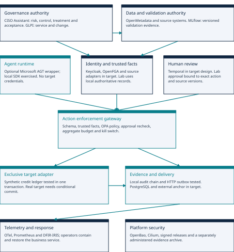
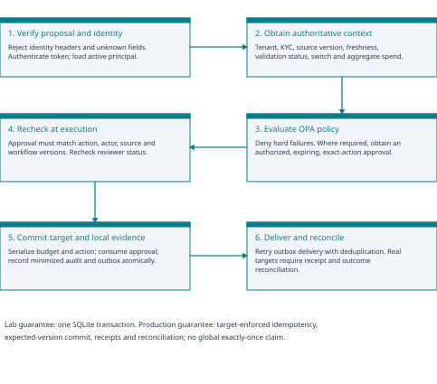
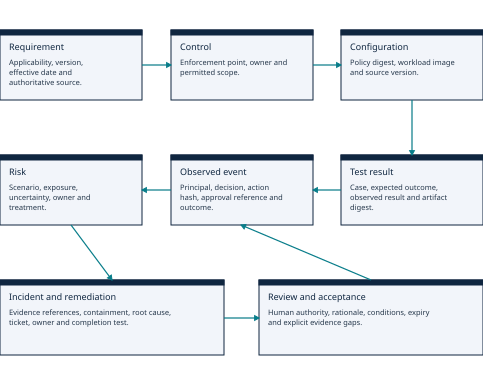

# Architecture

## Design objective

A governance decision must alter the permitted action path and remain traceable to a responsible owner and current evidence. Generating an assessment is one stage of that system.

The topology above shows the original lab and target boundaries. The expanded native implementation is in `fabric/enterprise/`; product-specific code and acceptance operations are listed in the [catalogue](components/catalogue.md).

## Planes and responsibilities

| Plane | Source of authority | Enforcement or record |
| --- | --- | --- |
| Organizational governance | Authorized risk, legal and business owners | CISO Assistant risks and conditions; GLPI service/change records. |
| Identity and delegation | Enterprise identities and record relationships | Keycloak token validation and OpenFGA relationship checks. |
| Runtime policy | Versioned business restrictions | OPA decision plus Microsoft AGT tool interception. |
| Data and model assurance | Source owners and validation authority | OpenMetadata classification/lineage and MLflow release evidence. |
| Execution | Permitted typed business operations | Gateway, Temporal approval, exclusive target adapter and PostgreSQL transaction. |
| Operational evidence | Observed decision and outcome records | Outbox receipts, telemetry, incidents and remediation. |

## Exact-action approval

Approval binds the actor, complete canonical action, case version, workflow version and policy version. It expires and is consumed once. Execution rechecks reviewer status and current restrictions. A changed action is a new approval request.

A repeated request with the same scoped idempotency key and unchanged payload retrieves the earlier receipt; it does not authorize another write. A different payload with that key is rejected.

## Evidence relationships

The useful property is traceability between requirement, risk, control, configuration, test, event, incident and acceptance. PostgreSQL stores local state and delivery receipts. It does not automatically provide immutable evidence. Privileged tampering requires separately administered signed checkpoints and retention controls.

## The native path

1. Keycloak verifies identity. The gateway ignores identity or role claims in a model payload.
2. Microsoft AGT restricts the exposed tool. OPA checks current business restrictions.
3. OpenFGA checks record scope. OpenMetadata, MLflow and GLPI supply required context.
4. Where required, Temporal waits for an approval reference. The gateway validates the stored approval.
5. PostgreSQL serializes the shared budget and commits the synthetic target change, audit and outbox together.
6. The dispatcher delivers evidence, incidents and remediation records to the native systems with per-sink receipts.
7. OpenTelemetry exports minimized spans; Prometheus and Alertmanager identify failures; operators respond through the runbook.

## Important limits

- PostgreSQL atomicity applies to the synthetic target inside its transaction. A real remote business API needs target idempotency, conditional updates, receipts and reconciliation.
- The supplied deployment is a dedicated synthetic lab, with development identity/workflow settings and private host bindings. It is not a hardened production installation.
- Single-use approvals do not prove that human reviewers make good decisions. Credit correctness, fairness and meaningful oversight require separate validation.
- The model proposes an action; it cannot set source status, identity, approval or budget facts.

See [design decisions](decisions/README.md) for tradeoffs and [validation](validation.md) for observed versus unverified behavior.
