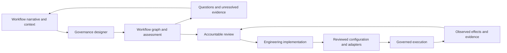
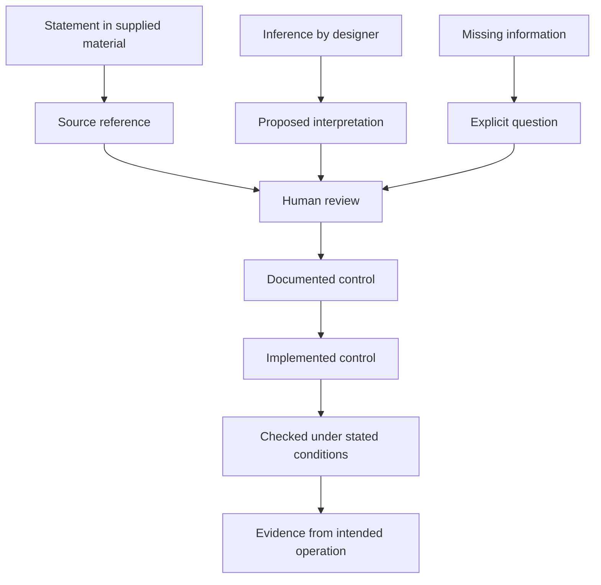
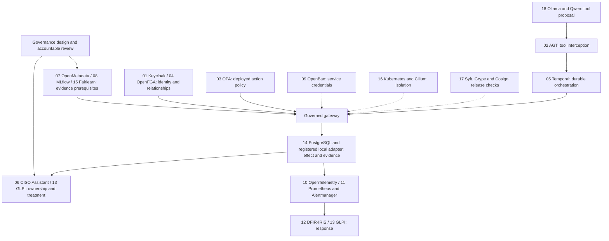

# From the Erdos framework to a reusable governance implementation

The starting point is Erdos Effect's [Implementing Governance for Agentic Workflows](https://www.linkedin.com/pulse/implementing-governance-agentic-workflows-erdos-effect-vipie), published on 1 November 2026 and shared through [the original short link](https://lnkd.in/p/ei3YEcEx). The complete public article and its publication metadata were read on 2 November 2026, including sections 3.1.1–3.1.7, 4.1–4.12 and the closing implementation discussion. Labels below are concise paraphrases; numeric references identify the original sections.

The source already connects workflow assessment with implementation, enforceable controls, evaluation and operational evidence. Our contribution is the engineering composition: explicit representations, product responsibilities, review artifacts, trusted execution boundaries and reproducible evidence. The eighteen-product selection and the control-family mappings are this project's choices; they are not requirements or endorsements from the source author.

`fabric/framework.py` is the shared, JSON-serializable catalog for the designer and documentation. It records the source, input/output references, all eighteen component groups, workflow-specific bindings and scoped implementation status. `docs/step-product-matrix.csv` is an earlier engineering crosswalk: its `our_capability` column contains our labels, not verbatim article headings. `docs/framework-mapping.csv` addresses other frameworks; it is a separate alignment aid and does not establish legal applicability or conformity.

## The contribution in one diagram

The first cycle helps a person understand and govern a proposed process. The second cycle implements a supported operation and checks its effects. A designer's output is a review artifact: it does not appoint an owner, grant a permission, register an adapter or approve deployment. The bridge marked **Engineering implementation** is deliberate work; it is not an automatic compilation of arbitrary prose into a runnable agent.

Two forms of reuse follow. The assessment representation can describe different processes, including their human and software participants. The runtime can execute multiple supported operation contracts, using registered adapters. A graph in an assessment can contain branches and handoffs that the current operation runtime does not execute as a general workflow graph.

## Input crosswalk

| Source reference and paraphrased area | Engineering representation and use | What still needs an accountable source |
| --- | --- | --- |
| 3.1.1 — Purpose and context | Retain workflow identity, intended outcome and scope beside the design. Runtime definitions have an ID, version and description. | Business baseline, operating jurisdictions, criticality and a named owner. |
| 3.1.2 — Process structure | The designer records actors, steps, decisions, information, tools and conditional edges with stable IDs. | Confirmation that the graph includes real exception paths and handoffs. |
| 3.1.3 — AI authority | Represent intended decisions separately from proposed controls. Execution uses authenticated actors, configured operations, role checks and exact task intent. | Actual delegated permissions and evidence that direct target access is restricted. |
| 3.1.4 — Information context | Link design entities to source evidence; runtime resources are scoped and versioned. Optional metadata checks require an owner and classification. | Production provenance, lawful handling, retention, quality and permitted data movement. |
| 3.1.5 — Accountability and impact | Keep human roles and proposed approval points explicit. Runtime approval requires a separate, currently authorized reviewer. | Appointment of real owners, meaningful review, stakeholder impact and redress arrangements. |
| 3.1.6 — Assessment criteria | Keep unknown applicability as a question. Reviewed operation definitions and native policy/metric bindings contain machine-checkable restrictions. | Qualified interpretation, dated requirements and approved organizational limits. |
| 3.1.7 — Safeguards and evidence | Preserve source statements separately from proposed controls and independently observed results. Attach evidence identifiers and implementation status. | Operational records proving effectiveness in the intended deployment. |

The natural-language designer uses bounded structured generation, checks schema and references, and requires quoted source fragments for stated graph entities. Finding a fragment in the input establishes that the text was supplied. It does not establish its truth or prove that every associated interpretation follows from it. Reviewers must check the graph, inferred risks and proposed controls.

## Output crosswalk

| Source reference and paraphrased area | Our engineering output | Boundary that remains explicit |
| --- | --- | --- |
| 4.1 — Understanding and gaps | Interpreted graph, stated/proposed/unknown entities, gaps and questions. | Review must identify invented detail, incorrect source labels and omitted paths; structural validation cannot prove fidelity. |
| 4.2 — Decision advice | A draft disposition and named categories of unresolved review work. | A generated recommendation is not release approval. |
| 4.3 — Analysis by step | Risks and controls link to graph step IDs and affected data. | A generic threat list is insufficient without process-specific review. |
| 4.4 — Risk records | Concrete scenarios, uncertainty and proposed triage, with optional GRC integration. | No fabricated probability, accepted residual risk or automatic risk closure. |
| 4.5 — Autonomy boundaries | Proposed approval/escalation points and configured runtime authority. | Intended restrictions must be compared with actual deployed permissions. |
| 4.6 — Control designs | Each proposed control has an enforcement point and a validation approach; trusted catalog families select relevant component roles. | Product selection alone does not implement a control. |
| 4.7 — Requirements traceability | Stable links among source evidence, steps, risks, controls and configuration identity. | Traceability does not settle legal applicability or certify compliance. |
| 4.8 — Validation design | Proposed tests and evaluation questions; the implementation has control tests, native contracts and scoped storage evidence. | Review must make proposed tests specific and falsifiable; representative process data, human factors and independent validation remain separate. |
| 4.9 — Operational response | Monitoring/response recommendations and existing telemetry, alert, incident and stop mechanisms. | New deployment thresholds, on-call ownership and recovery drills require commissioning. |
| 4.10 — Value and restraint | Questions about measurable benefit, control cost and an appropriate level of autonomy. | The project has not demonstrated business savings or an optimal autonomy level. |
| 4.11 — Remediation priorities | Actionable gaps and linked proposed controls; optional ticket/evidence delivery. | A recommendation does not become completed work without acceptance evidence. |
| 4.12 — Assessment history | Source/configuration identities, versioned artifacts, recorded decisions and evidence references. | Material change requires review; an audit hash is not immutable external custody. |

## Keep source status and assurance status separate

The upper part identifies where a design statement came from. The lower part describes what has been demonstrated about a control. These are different axes. A source can assert that an approval gate already exists; the assessment should record that assertion while leaving operational effectiveness unverified. A passing synthetic test does not appoint a risk owner or approve a production deployment.

The source's emphasis on differentiated assurance is retained here. We implement that distinction with explicit provenance, design states, test scopes and product status records, rather than collapsing them into one score.

## How all eighteen groups fit

This is a responsibility diagram, not proof that all services are connected. Dashed links indicate deployment controls that require their own acceptance. Component groups can be selected for a deployment's needs; choosing fewer products does not remove the underlying requirement for enforceable authority, accountable ownership or evidence.

| ID | Component group | Reusable responsibility | Workflow/deployment binding |
| --- | --- | --- | --- |
| 01 | Keycloak | Signed identity before trusted runtime role lookup. | Realm, audience, principal mapping and provisioned roles. |
| 02 | Microsoft AGT | Operation-specific tool interception. | Allowed operation IDs and workload identity. |
| 03 | OPA | Independent, configured action decisions. | Policy package, configuration digest, roles and tenants. |
| 04 | OpenFGA | Resource relationship checks. | Model vocabulary and workflow/tenant-scoped tuples. |
| 05 | Temporal | Durable progress, retry and approval waiting. | Worker delegation, queue and timeout. |
| 06 | CISO Assistant Community | Accountable risk/control/evidence records. | Assessment scope, risk IDs, owners and acceptance roles. |
| 07 | OpenMetadata | Asset classification and ownership checks. | Entity, collection, name and required tag. |
| 08 | MLflow | Evaluation records and approved-release prerequisite. | Model identity, tenant, metric gates and expiry. |
| 09 | OpenBao | Separated service credentials. | Secret paths, workload policies and rotation. |
| 10 | OpenTelemetry Collector | Minimized correlated operational traces. | Instrumentation, attributes, exporter and retention. |
| 11 | Prometheus / Alertmanager | Metrics and routed alerts. | Thresholds, recipients and response ownership. |
| 12 | DFIR-IRIS | Incident recording and investigation. | Customer scope and workflow correlation. |
| 13 | GLPI | Inventory scope and remediation tickets. | Resource type/ID, entity and support process. |
| 14 | PostgreSQL | Serialized local effects and durable evidence. | Trusted provisioning, database authority and recovery. |
| 15 | Fairlearn | Supported group-metric calculation. | Representative dataset, groups and valid evaluation criteria. |
| 16 | Kubernetes / Cilium | Workload/network isolation patterns. | Topology, identities, routes and isolation tests. |
| 17 | Syft / Grype / Cosign | Inventory, vulnerability and signature checks. | Built artifact, scan gate and signing trust. |
| 18 | Ollama / Qwen | Bounded proposal generation and observation processing. | Model/endpoint, tool schemas and inference budgets. |

For example, an approval control can map to identity (01), policy (03), a durable wait (05) and accountable records (06). That mapping identifies engineering responsibilities. It does not imply that installing those four products makes review meaningful or proves an approval cannot be bypassed.

## What is shipped and what is evidenced

**Repository implementation.** The configurable runtime, strict operation definitions, synthetic credit/access adapters, authenticated task API, agent loop, design/package generation and native binding code are present. The natural-language designer adds a bounded graph-and-assessment review surface. Its code and validation belong to their stated scope; they must not inherit the evidence of an older synthetic experiment merely because the same component names appear.

**Local configurable evidence.** `results/configurable-validation/run-summary.json` records the combined regression boundary. `results/native-postgres/20261102T093819Z/summary.json` records isolated real PostgreSQL 16.2 checks for both configurable workflows, including approval, concurrency and restart. The target effects are synthetic tables. This newer storage evidence supersedes the earlier host limitation for that specific check; it does not rewrite the historical record or establish a full native stack.

**Historical native observations.** `results/native-component-status.json` records selected real-product operations in earlier lab/subset or isolated experiments. Its Keycloak, FGA, Temporal, OpenBao, monitoring and Qwen observations belong to those runs. Separate CISO Assistant, MLflow/Fairlearn and collector experiments also have limited scopes. A selected MLflow prerequisite does not prove that the bytes of the inference model being served match its registry release.

**Unfinished deployment acceptance.** OpenMetadata, DFIR-IRIS and GLPI live commissioning remains unverified. Kubernetes/Cilium isolation acceptance remains unverified. The recorded supply-chain experiment failed its vulnerability gate; successful local signing did not override that result. The deployment-pinned collector was not qualified by the compatibility-version experiment. `results/all-18-live.json` does not report a complete pass, and no production-readiness or certification claim follows from the new designer or runtime.

The [validation record](validation.md) and [configurable workflow guide](configurable-workflows.md) carry the detailed boundaries. In particular, a remote business target needs its own idempotency, conditional-write, delivery and reconciliation contract. The current transactional local adapter interface does not make an arbitrary remote API atomic with PostgreSQL.

## Practical collaborator review

A useful first review uses one real process description and asks whether its reconstructed actors, steps, decisions and handoffs are correct. Reviewers can then inspect the proposed risks, control locations, unresolved questions and component responsibilities. Only after that review should an implementation owner select supported operation contracts, authoritative data ingestion, adapters, policy bindings and acceptance tests.

The synthetic credit and IT access examples establish that different operation schemas can share enforcement machinery. They do not establish that every process is already executable. The intended reusable outcome is a consistent path from a process description to reviewable governance decisions, followed by a deliberately engineered and evidenced implementation.
