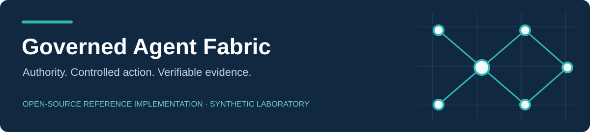
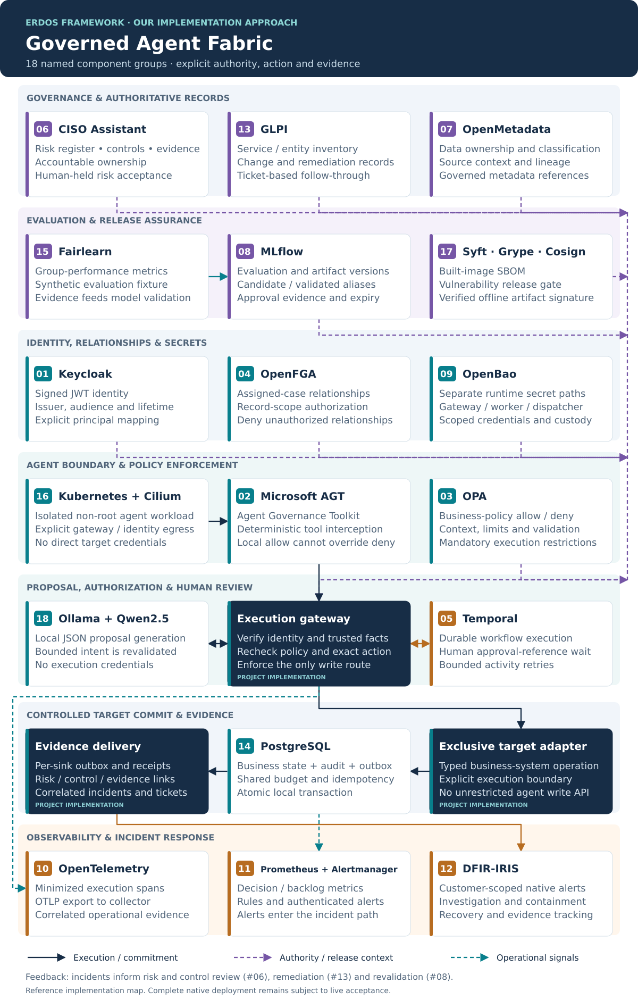
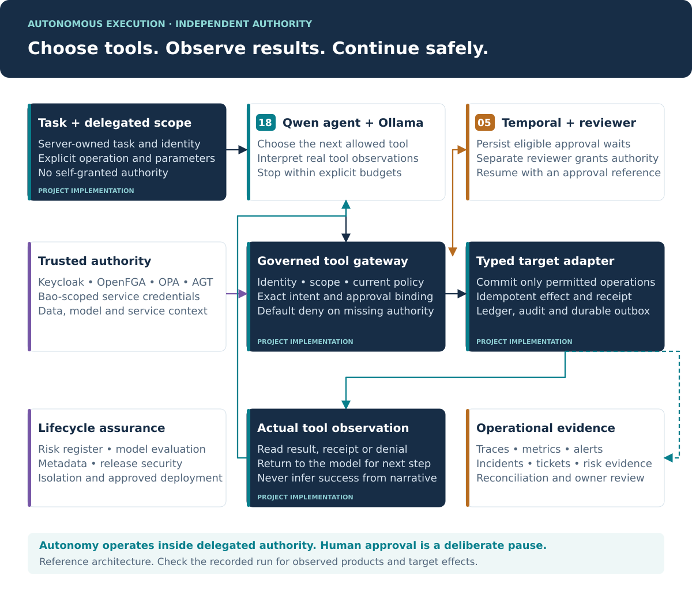

# Governed Agent Fabric

Our domain-independent autonomous agent fabric extends the Erdos governance framework across risk, authority, assurance, action, evidence and response. The agent chooses tools, observes real results and continues within delegated authority; the surrounding products enforce controls and support operations.

Start with the [quickstart](getting-started.md), inspect the [architecture](architecture.md), or open the [18-component catalogue](components/catalogue.md). For a complete installation, follow the [commissioning guide](deployment/full-stack.md).

For reusable workflows, start with [configurable workflow contracts](configurable-workflows.md). The shared runtime loads separate credit and access-request definitions, generates assessment/implementation packages, and enforces their configured authority, approval and budget rules. The original lab remains available for reproducing historical evidence.

For a process described in ordinary language, use the [governance designer](workflow-designer.md). Read the [illustrated generalisation briefing](Governed_Agent_Fabric_Generalisation.pdf) and [framework extension map](framework-extension-map.md) to follow the original assessment model into our design, implementation and evidence paths.

!!! warning "Evidence boundary"
    The original core has 51 observed checks. Actual Qwen tool loops and a connected Temporal approval/restart journey have now run in a native subset. The complete eighteen-product deployment remains unverified. Read the [native study](research/native-agent.md), [per-product evidence](validation.md) and limitations.

The [research paper](Governed_Agent_Fabric_Research_Paper.pdf) discusses the rationale, standards, experiment and limitations. The [risk register](risk-register.json), [step/product matrix](step-product-matrix.csv), [integration contracts](integration-contracts.json) and [framework mapping](framework-mapping.csv) are machine-readable companion artifacts.

## Reading paths

- **Architecture and risk:** architecture → component catalogue → design decisions → research paper.
- **Implementation:** quickstart → full deployment → API → live acceptance.
- **Operations:** deployment → operations runbook → security reporting → evidence interpretation.

See [the repository](https://github.com/CodeDaim0n/AI-governance-repo) for code, issues and version history.
