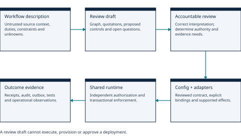
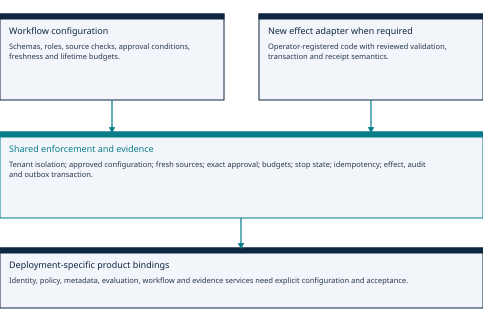
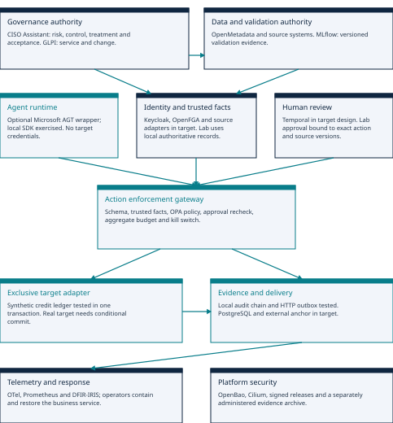
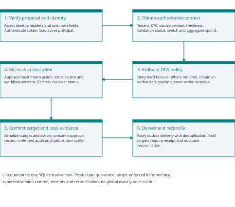
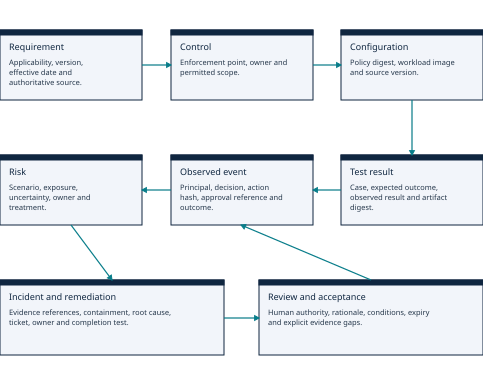
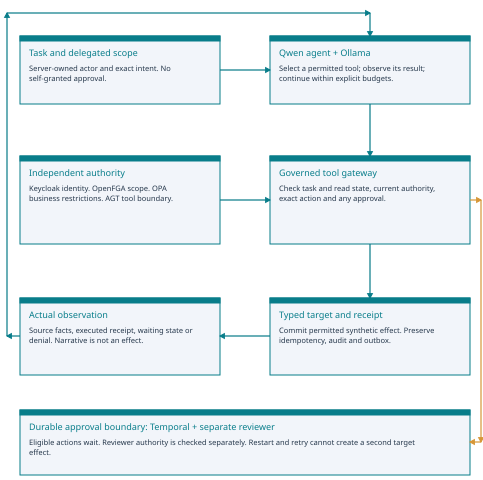

# Governed Agent Fabric

Reusable workflow governance: from process description to bounded execution

**A review-assisted designer and configurable enforcement fabric, with explicit authority and evidence boundaries.**

| Research implementation, edition 0.5 | Evidence and scope |
|---|---|
| Reusable enforcement and 18 component roles | Shared runtime; synthetic credit and IT-access configurations; reviewed effect adapters |
| Current regression | 129 core tests including 29 designer/CLI tests; 12 Rego checks; 77 enterprise contracts; 3 AGT assertions |
| Workflow-to-governance design | Live prose-design observations with failures and source-comparison findings retained |

### Abstract

We extend the Erdos workflow-assessment framework into a reusable engineering composition: a natural-language governance designer, versioned workflow contracts, shared enforcement, registered effect adapters and operational evidence. The designer proposes a workflow graph, risks, controls and questions; accountable review and engineering connect supported designs to execution. The same runtime supports synthetic credit and IT-access operations through distinct configuration.

Evaluation separates simulated contracts, real OPA/PostgreSQL checks and live model observations. The latest vendor-onboarding draft passed mechanical validation but source comparison found material governance defects; museum drafts were rejected. This supports a review-assisted prototype, not unattended design. Historical control and native-agent results remain separately scoped. Complete eighteen-product acceptance, business validity and production readiness remain unestablished.

Prepared 2 November 2026 | Technical working paper | Not peer reviewed

No real customer data, banking systems or production credit decisions were used. Named organizational owners, regulatory applicability decisions and product deployment approvals remain unassigned.

## Paper navigation

Edition 0.5 adds the reusable runtime, prose designer and current evidence first. Original control results and later native experiments retain their own scope and historical labels. Page numbers and PDF bookmarks are generated from the rendered headings.

| Section | PDF page |
|---|---|
| Research question and evidence boundary | 4 |
| Extending the Erdos framework in practice | 5 |
| From a process description to governed execution | 6 |
| What is reusable, configurable or newly implemented? | 7 |
| Runtime contract and effect boundary | 8 |
| Seven framework inputs: candidate coverage, not completeness | 9 |
| Twelve outputs: review artifacts with reserved authority | 10 |
| Prose design method, bounded repair and provenance | 11 |
| Empirical method: contracts, policies and real storage | 12 |
| Five native design runs: retain failures and interruptions | 13 |
| A mechanical pass still contains substantive defects | 14 |
| Validity, reproduction and the next research questions | 15 |
| Architecture: responsibilities and trust boundaries | 16 |
| Execution flow and decision invariants | 17 |
| Identity, delegation and exclusive execution | 18 |
| Microsoft AGT: adopt, integrate and constrain | 19 |
| Risk register and accountable acceptance | 20 |
| Worked risk: action changes after approval | 21 |
| Data, model and business-system authority | 22 |
| Workflow, approvals and distributed effects | 23 |
| Evidence graph, retention and integrity | 24 |
| Telemetry, incidents and service resilience | 25 |
| Input crosswalk: sections 3.1.1-3.1.7 | 26 |
| Output crosswalk: sections 4.1-4.6 | 27 |
| Output crosswalk: sections 4.7-4.12 | 28 |
| Framework alignment and regulatory scope | 29 |
| OWASP threats: initial evidence snapshot | 30 |
| Method and reproducible experimental setup | 31 |
| Observed results and interpretation | 32 |
| Product deployment and acceptance roadmap | 33 |
| Limitations and interpretation of the initial experiment | 34 |
| Primary sources 1-9 | 35 |
| Primary sources 10-18 | 36 |
| Primary sources 19-27 | 37 |
| Primary sources 28-30 | 38 |
| Component role catalogue 1-6 | 39 |
| Component role catalogue 7-12 | 40 |
| Component role catalogue 13-18 | 41 |
| Native integration package: edition 0.2 | 42 |
| Native component acceptance 1-9 | 43 |
| Native component acceptance 10-18 | 44 |
| Commissioning, evidence and release limits | 45 |
| Products brought together 1-9 | 46 |
| Products brought together 10-18 | 47 |
| An autonomous agent fabric | 48 |
| Protocol, artifacts and observations | 49 |
| Results: task success is not safety | 50 |
| Connected approval, restart and resumption | 51 |
| Observed product boundaries 1-9 | 52 |
| Observed product boundaries 10-18 | 53 |
| Negative results and release implications | 54 |
| Actual risk records, controls and evidence | 55 |
| Primary sources and evidence index | 56 |

## Research question and evidence boundary

### Question

How can governance remain enforceable across workflow-specific identity, data, models, people and tools, while reusing assessment structures and enforcement machinery? Edition 0.5 also asks what a model-generated governance design can establish before accountable review and implementation.

### Contribution

The contribution is an engineering composition and reproducible control laboratory: explicit design contracts, a configurable enforcement engine, registered adapters and evidence-linked review. Existing policy engines, durable workflows, identity systems and risk registers supply complementary capabilities. The original framework already addresses implementation, enforceable controls, evaluation and operational evidence; the eighteen-product selection is this project's choice, not a source requirement or endorsement. [1]

| Evidence level | Meaning in this paper |
|---|---|
| Specified | A responsibility, interface or operating rule has been designed. |
| Configured | A configuration or schema is supplied; a configuration file alone is not proof it works. |
| Tested locally | Code ran with a synthetic system and expected results were checked. |
| Integrated with selected product | A native product interface was exercised, with a version and result recorded. |
| Observed in production | Requires real deployment and operational evidence. No component has this status here. |

### Observed scope

OPA 1.0.1 was run as a real local HTTP service. The Python gateway, signed-token checks, local approval and credit-ledger transactions, and an HTTP outbox sink were exercised. Microsoft agent-governance-toolkit-core 5.0.0 was installed into an isolated target directory and its govern wrapper was exercised in three cases. The wider product catalogue is a target architecture, not a running 18-product deployment.

### What cannot be concluded

The original control experiment had no generative model. Edition 0.3 added native Qwen tool experiments; edition 0.5 adds prose-design observations and configurable-runtime regression. Neither test counts nor mechanical design acceptance establish semantic adequacy, representative business outcomes or complete deployment acceptance. Self-authored tests and assistant source comparisons require independent human challenge.

## Extending the Erdos framework in practice

The Erdos governance framework defines workflow assessment inputs and outputs, including operational evidence, enforcement and accountable decisions. In this work, we extended that structure into a product-based reference architecture and implementation package. The choices below show our practical implementation approach while preserving the framework's assessment model. [1]

| Implementation focus | Our implementation approach |
|---|---|
| Authoritative system context | Fetch facts from designated systems of record; retain timestamps, versions and unknown-data status. |
| Execution controls | Place mandatory enforcement at the gateway and target adapter, with scoped target credentials. |
| Action-specific approval | Bind approval to actor, exact payload, source version, workflow version, policy version and expiry. |
| Cross-system consistency | Define source precedence, freshness, fail-closed behavior, target receipts and reconciliation. |
| Connected risk records | Maintain stable risk identities with control, test, event and incident references. |
| Shared exposure boundaries | Enforce aggregate budgets and cross-workflow limits through an authoritative service. |
| Evidence and independent validation | Connect observed controls with validation, business outcomes, customer impact and time-limited acceptance. |
| Exclusive write path | Separate agent networks and secrets; verify permitted routes and delegation boundaries. |

### Implementation scope

We preserve the framework workflow inputs and governance outputs while making product responsibilities, interfaces, enforcement decisions and evidence paths explicit. The observations in this paper describe the supplied synthetic implementation and its stated test scope.

## From a process description to governed execution

The generalisation separates three artifacts: a model-assisted governance draft, an engineering contract, and an observed execution record. They have different authors, validation requirements and authority. A useful draft can guide implementation without being executable or sufficient for release.

### Two connected contributions

First, a shared runtime executes multiple declared workflows through the same enforcement engine. Second, a structured Ollama designer interprets prose into a workflow graph, proposed controls and questions. The synthetic credit and access profiles demonstrate the former; vendor onboarding and museum lending are exploratory descriptions for the latter. Their domains are not silently substituted.

Accountable review remains a separate decision. A reviewer must correct source interpretation, determine actual permissions and obligations, and establish implementation and validation requirements. The designer has no business tools, target credentials, provisioning endpoint or approval operation.

This extension operationalises the Erdos workflow-input and assessment-output structure [1]. It does not claim that product selection is prescribed by that framework or that structured output constitutes framework conformity. The source already includes enforcement, evaluation and operational evidence.

## What is reusable, configurable or newly implemented?

The shared engine supplies authorization, approval, freshness, idempotency, aggregate limits and evidence semantics. Workflow configuration supplies supported domain rules. An effect adapter supplies target behavior when a new action cannot be represented by an existing reviewed adapter. A new control mechanism outside the contract requires explicit implementation and tests.

### Product reuse is conditional

The eighteen component groups are a responsibility map. Identity realms, relationship tuples, metadata entities, model metrics, workflow queues and risk/evidence links remain deployment-specific. Existing clients and platform patterns can be reused, but new bindings still need commissioning and acceptance. The diagram does not mark the full native stack as operational.

The supplied legacy credit path remains a compatibility fixture for earlier experiments. New definitions use the configurable modules and cfg_ table family; old records are not silently migrated. Historical product observations do not approve new identities, source mappings, workflow configurations or targets.

Teal denotes the shared path exercised by selected local contract and storage checks. The new adapter and enterprise bindings remain engineering and deployment responsibilities, rather than model-generated authority.

## Runtime contract and effect boundary

Every action contains exactly workflow_id, operation, resource_id, parameters and idempotency_key. Identity, tenant, resource facts, configuration and target endpoints are resolved by trusted services. Definitions use schema_version 1 and a digest of the complete workflow definition; changing a declared adapter binding or rule invalidates approval even when a human-readable version is unchanged. External native-service settings require separate change control.

| Contract element | Enforcement / scope |
|---|---|
| Operation schema | Bounded string, integer and Boolean parameters; unknown fields fail validation. |
| Resource predicates | Declared comparisons over authoritative stored attributes; no eval or arbitrary imports. |
| Approval | Separate current reviewer; exact action, actor/resource state, configuration and deployment approval version; expiry checked. |
| Shared budgets | Positive integer lifetime counters across actors within workflow, operation and tenant; optional resource scope. |
| Current authority | Active roles, tenant isolation, source freshness, approved configuration and stop state remain enforced. |
| Policy composition | External policies add restrictions; they cannot convert an internal denial into permission. |
| Adapter selection | Operator-registered identifier, never a model-supplied import path, URL or shell command. |

### Local atomicity is not a remote transaction guarantee

Adapters expose validate(operation) and apply(connection, context). The included credit-ledger and access-directory effects are synthetic local writes. Effect, usage, consumed approval, audit and outbox commit together. Scoped records retain receipts; audit/outbox fields are minimized. A hash chain detects modification but is not an independently immutable archive.

An HTTP call inside apply cannot be undone by a database rollback. Remote targets require target idempotency, conditional writes, durable delivery and reconciliation. Nested parameter objects, arbitrary expressions, rolling budgets and general graph execution are outside the current contract. Administration and explicit fixture provisioning remain separate from the agent API.

## Seven framework inputs: candidate coverage, not completeness

The designer retains the original section identifiers and uses concise paraphrased labels [1]. The crosswalk below explains the implementation contribution and the evidence still required. A source mention changes coverage to requires_review; it does not establish completeness or applicability.

| Source ID / paraphrased area | Candidate representation and remaining review |
|---|---|
| 3.1.1 Purpose and context | Source facts and questions; establish intended outcomes, boundaries and baseline measures. |
| 3.1.2 Process structure | Actors, steps, decisions and edges; confirm ordering, handoffs, exceptions and resumption. |
| 3.1.3 AI authority | Proposed duties and tool links; verify real permissions, delegation and prohibited effects. |
| 3.1.4 Information context | Data entities and quotations; verify provenance, sensitivity, reliability and retention. |
| 3.1.5 Accountability and impact | Proposed human roles; name accountable people and assess affected parties and redress. |
| 3.1.6 Assessment criteria | Requirements as source claims; obtain versioned authority and qualified applicability decisions. |
| 3.1.7 Safeguards and evidence | Described safeguards; obtain tests, operating records, incidents and change evidence. |

### Grounding has a deliberately narrow meaning

Evidence contains exact contiguous quotations and offsets in the supplied description. Facts reference those quotations instead of introducing a separate verified-fact narrative. Every entity marked stated requires evidence references. Proposed and unknown entities, assumptions, and open questions remain explicit in the artifact.

These checks establish source presence, not truth or entailment. A genuine quotation may be attached to an unsupported inference. Likewise, a source-described control is not independent evidence that the control operates. Review must distinguish intended duties, actual permissions and demonstrated behavior.

The complete framework catalog is fabric/framework.py; docs/framework-extension-map.md records the source/engineering boundary and component relationships. No model-generated coverage status substitutes for an accountable assessment.

## Twelve outputs: review artifacts with reserved authority

All twelve source output areas are retained. Their structured content is assembled from the validated draft and deterministic defaults. The labels below are paraphrases; the proposed product mappings and implementation status belong to this project. Every area remains a draft requiring review.

| Source ID / paraphrased output | Generated contribution and boundary |
|---|---|
| 4.1 Understanding and gaps | Source coverage, assumptions, gaps and questions. |
| 4.2 Decision advice | Draft recommendation; production and deployment approval false. |
| 4.3 Analysis by step | Step-to-risk and step-to-control references. |
| 4.4 Risk records | Proposed scenarios and priorities; no residual-risk acceptance. |
| 4.5 Autonomy boundaries | Actors, tools and decisions; actual permissions unverified. |
| 4.6 Control designs | Proposed controls and explicit implementation gaps. |
| 4.7 Requirements traceability | Candidate evidence links; applicability and mapping require review. |
| 4.8 Validation design | Proposed tests; execution status not_run and no measured results. |
| 4.9 Operational response | Monitoring/response suggestions; recovery not rehearsed. |
| 4.10 Value and restraint | Benefits, costs and proportionality not established. |
| 4.11 Remediation priorities | Open remediation; human ownership and dates unassigned. |
| 4.12 Assessment history | Versions, source digests and reassessment triggers; no release decision. |

Human-owner references must resolve to actors declared human. This validates a structural relationship, not that a named role exists, has been appointed, is independent, or possesses the required competence. Risk acceptance, legal applicability, final release and operational commissioning remain external decisions.

## Prose design method, bounded repair and provenance

An operator selects an Ollama endpoint and model. The description is untrusted data, and inference requests supply the JSON schema for structured output [28-30]. The current prompt asks for all explicit authority restrictions and exception, handoff and post-decision paths within schema limits, using concise field text rather than fixed step/risk/control targets.

| Boundary | Current implementation |
|---|---|
| Input / transport | At most 12,000 characters; explicit HTTP(S) endpoint; no redirects or ambient proxy configuration. |
| Response / content | 512 KiB response and 256 KiB design limits; strict duplicate-key, finite-number, Unicode and unknown-field checks. |
| Mechanical validation | Category-specific IDs, typed references, exact quotation presence and human-only accountable owners. |
| Correction | At most two total attempts; up to 64 safe diagnostic codes. Complete rejected JSON included only within 16 KiB. |
| Reasoning option | Operator Boolean; 8,192 or 12,288 generation tokens with 16,384 context. Optional thinking field bounded to 128 KiB. |
| No execution authority | Always draft_requires_review; execution disabled, runtime definitions empty and deployment approval false. |

### Observed provenance and time limits

Artifacts record source, prompt, schema, model-draft and artifact digests, reported model metadata, requested reasoning mode and attempt outcomes. Provider reasoning is excluded from design, report, repair and logs; optional diagnostic capture separately retains the full provider response. Hashes support traceability, not independent model-identity attestation.

The maximum configured budget is 600 seconds shared across attempts. Deadlines are checked before requests and between chunks; an in-flight HTTP operation may extend beyond that deadline. Hard wall-clock cancellation needs an external worker deadline. A malformed-Unicode guard was added after the final native run; regression covers it, while that run retains its original source hashes. The generation prompt and schema were not changed by this parser fix.

## Empirical method: contracts, policies and real storage

The 2 November 2026 regression distinguishes simulated provider contracts from actual policy and storage execution. The local WSL run used Python 3.14.4, OPA 1.0.1 and PostgreSQL 16.2. Self-authored fixtures exercise selected invariants; they are neither a statistical safety estimate nor product certification.

| Evidence group | Result | Scope |
|---|---|---|
| Core regression | 129 passed | Zero failures, errors or skips; includes 29 designer/CLI tests. |
| Designer/CLI subset | 29 passed | Simulated inference: schema, repair, Unicode, transport and authority boundaries. |
| Rego checks | 12 passed | Original and configurable policy checks executed with OPA. |
| Enterprise contracts | 77 passed | Native API/configuration contracts; other service responses simulated. |
| AGT wrapper | 3 assertions | Installed govern wrapper; no full toolkit qualification. |
| Real PostgreSQL | PASS | Original controls, two configurable workflows and restart receipt replay. |
| Compilation / docs | Passed | Source compilation and strict documentation build. |

Both configurable workflows denied execution before independent approval and reused receipts afterward. Approval substitution and changed configuration were denied. 12 concurrent duplicate requests produced 1 additional effect. A shared resource budget across 2 actors admitted 10 of 15 requests and denied 5. The 13 executed events matched 13 outbox effects; restart replay introduced no new effects. Targets remained synthetic local tables.

The original CI failure arose from SQL_ASCII text returned as bytes. The runner now initializes UTF8 and checks fetch/rebind behavior. A later PostgreSQL decimal usage-sum result required validated normalization before serialization. Failed records and passing reruns are retained; neither change establishes complete eighteen-product live acceptance.

## Five native design runs: retain failures and interruptions

Ollama served the recorded qwen3:8b model, identified in its catalogue as 8.2B parameters and Q4_K_M quantization. Two synthetic descriptions were reused during development. Prompts, compatibility handling and repair changed adaptively; the final two runs requested reasoning. These observations are not a benchmark or a controlled comparison of reasoning modes.

| Development stage | Vendor onboarding | Museum loan |
|---|---|---|
| Initial intake | Provider metadata rejected; correction timed out; 600.02 s | Interrupted; no completed result |
| Metadata compatibility | Duplicate IDs after both attempts; 408.50 s | Interrupted; no completed result |
| Prefixed identifiers | Invalid references; repair removed a referenced actor; 405.01 s | Interrupted; no completed result |
| Reasoning requested | Mechanical pass after correction; 288.70 s | References failed after two attempts; 353.09 s |
| Complete-path prompt | Mechanical pass on first attempt; 173.05 s | Quotations and references failed after two attempts; 465.34 s |

### What the accepted records establish

The first accepted vendor draft had five steps, three risks and three proposed controls; the final accepted draft had six steps, three risks and three controls. Acceptance here means only the configured mechanical checks passed. Both drafts required substantive revision after source comparison. No accepted museum artifact was produced, and interrupted museum cases are not counted as successes or failures.

Each run retains its implementation and input hashes, recorded outcomes and available provider responses. The five directories, in table order, are 20261102-prose-intake, 20261102-prose-intake-fixed, 20261102-prefixed-designs, 20261102-reasoning-designs and 20261102-complete-graphs under results/workflow-designer/. The two accepted vendor records are observations of changing development revisions, not independent repeated trials.

## A mechanical pass still contains substantive defects

An independent assistant compared the accepted vendor drafts with their supplied description. The latest artifact preserves four source roles, separate-channel finance verification, unknown tool permissions and proposed human owners. It quotes forbidden AI effects and identifies prompt injection and unauthorized vendor addition. These improvements do not make its process design correct.

| Finding in latest vendor draft | Required substantive revision |
|---|---|
| Effect before final decision | Vendor addition precedes accept/reject. Establish acceptance prerequisites before the write; rejection must produce no effect. |
| Incomplete exception path | Missing/conflicting records need an explicit paused state, review completion and resume condition; rejection needs an explanation. |
| Weak risk-control fit | Bank verification does not enforce the AI write restriction. Specify independent boundaries for bank changes, vendor writes, orders and payments. |
| Unsupported stated authority | Final acceptance authority and serial sequencing are inferred. Mark them proposed and obtain accountable confirmation. |
| Underspecified validation | Define invalid inputs, positive controls, expected decisions, unchanged target state and correlated evidence; alteration alone is not invalidity. |
| Missing information/context | Represent recommendation and verification evidence, record versions, rejection explanation, escalation and workflow-specific evaluation needs. |

### Implication for governance automation

Valid references can connect the wrong concepts, and genuine quotations can support neither the attached inference nor the claimed authority. The source comparison is diagnostic assistant review, not human approval, factual verification or operational assurance. The museum failures establish mechanical rejection only; invalid responses were not promoted into an accepted design.

These findings support a review-assisted prototype. They do not support unattended governance design for arbitrary processes, reliable identification of every restriction or risk, or automatic translation from a prose graph into an approved runtime contract. The absence of execution authority limits what a flawed draft can do, but does not remove the need to correct it before implementation.

## Validity, reproduction and the next research questions

Two synthetic descriptions and one local model identity cannot establish domain generality. Adaptive prompt changes, repeated exposure to the examples, caching and hardware conditions prevent causal claims from latency differences. Assistant review lacks blinded human annotations. Simulated service responses and self-authored tests can share omissions with the implementation. Real PostgreSQL success does not qualify remote targets or the complete native stack.

### Reproduce the correct evidence layer

Run the ordinary core discovery and tests/enterprise suite for contract regression. The native PostgreSQL runner exercises storage concurrency and restart. For a new model observation, run scripts/run_workflow_designer.py with an explicit installed model, supplied descriptions and a new empty output directory; --thinking records the reasoning request, while --capture-model-responses retains sensitive source-derived content and provider reasoning. Keep failures and source hashes.

| Repository evidence / entry point | Purpose |
|---|---|
| results/designer-validation/ | Final regression summary, policy/toolkit checks and PostgreSQL log. |
| results/workflow-designer/*/run-summary.json | Five development runs; interrupted cases have separate records. |
| 20261102-complete-graphs/source-comparison.json | Latest vendor findings and absence of an accepted museum artifact; path relative to results/workflow-designer/. |
| fabric/framework.py; docs/framework-extension-map.md | Seven inputs, twelve outputs and project component crosswalk. |
| docs/configurable-workflows.md; docs/workflow-designer.md | Supported contracts, model operation, limits and reproduction commands. |

### Next research

Freeze model, prompt, schema and runtime revisions before held-out evaluation. Have independent domain reviewers annotate authority restrictions, exceptions and risk-control links; report agreement, correction effort and missed constraints alongside mechanical acceptance. Compare reasoning and repair strategies under controlled conditions. Extend remote-effect reconciliation under fault injection, then commission and test each required native component. Review drafts, enforced actions and operational approval must remain separate throughout that work.

## Architecture: responsibilities and trust boundaries

Historical topology of the original control experiment. Teal boxes identify that experiment's exercised path; other labels describe its target architecture. Later Keycloak, OpenFGA, Temporal and other native observations, and the newer PostgreSQL checks, have separate scopes below. This diagram is not a current per-product acceptance matrix.

The governance authority owns policy and risk decisions. The execution authority enforces them. The evidence plane records decisions and outcomes. Data and validation authorities supply trusted facts; model-generated content cannot amend those facts.

## Execution flow and decision invariants

### Commit invariant

A new write is permitted only when identity is active; principal and case share a tenant; the tool is allowlisted; required facts are fresh and valid; workflow validation remains current; the switch permits execution; both single-action and aggregate limits hold; and any required approval remains valid.

### Important retry distinction

A duplicate request with the same actor, tenant, idempotency key and payload returns its prior receipt without creating a new write. It may return an existing receipt after a stop or source expiry. A changed payload with the same key is rejected. This is intentional retrieval of an earlier outcome, not renewed authorization.

## Identity, delegation and exclusive execution

### Keycloak: authenticate the actor

The target uses Keycloak for human and service identities through OpenID Connect. The gateway must validate issuer, intended audience, signature, token lifetime and authorized client, using a trusted discovery/JWKS configuration. Tenant, role and task scope must originate from trusted identity and authorization services. A tool-call body cannot nominate its own privileges. [8]

### OpenFGA: authorize relationships

Record-level relationships constrain the delegating user, workload identity, current task and target resource. A relationship grant cannot waive OPA restrictions. The original control lab used local relationships; later native-agent trials exercised OpenFGA. Configurable bindings and their simulated contracts still require deployment-specific models, tuples and native acceptance. [9]

### Microsoft AGT: intercept agent proposals

AGT is used at the agent runtime boundary to reject unrecognized tools before they reach a gateway. Its independently configured policy cannot turn a central deny into an allow. Dynamic trust scores, if adopted, may restrict authority or trigger review; they must not create a legal delegation or silently expand a business limit.

### OpenBao and platform isolation: protect the only write route

OpenBao is the proposed source of short-lived adapter credentials and certificate/key operations. Kubernetes and Cilium should restrict agent egress to the authenticated gateway, with target credentials available only to the adapter. Database accounts and administrative roles must not share the agent runtime. [10]

### Implemented boundary and remaining work

The original lab verifies a narrow RS256 token profile and a server-owned active-principal table. Its local keys and loopback server are distinct from the later native Keycloak/JWKS client and authenticated configurable API. Later subset trials exercised native identity and relationship checks. Production rotation, federated logout, mTLS, replay defense and network bypass acceptance remain separate requirements.

## Microsoft AGT: adopt, integrate and constrain

AGT is a Microsoft-hosted, MIT-licensed runtime governance project in Public Preview. Current documentation describes policy, identity, isolation and reliability capabilities and support for external policy engines. Our architectural evaluation treats those as useful components, rather than assuming that every capability is enabled or equally mature across packages and languages. [7]

| Responsibility | AGT fit | Required enterprise connection |
|---|---|---|
| Tool interception | Useful wrapper and framework integration surface | Mandatory remote gateway with independent target enforcement |
| Policy | Can host/integrate governance policy | One centrally managed OPA business-policy authority; versioned contract |
| Identity and trust | Agent identity/trust capabilities are available | Map to enterprise IAM, real delegation, customer/record permissions |
| Isolation and termination | Runtime/sandbox and stop capabilities are available | Credential revocation, network restriction and service recovery |
| Evidence | Runtime governance evidence is available | Correlate with approvals, target receipts, GRC and incident records |
| Risk management | Evidence and mappings can inform risk processes | CISO Assistant remains our designated risk acceptance record |

### What was actually exercised

The core 5.0.0 govern wrapper permitted credit.commit to reach OPA; rejected an unknown shell.exec action; and allowed a proposal that OPA independently rejected for crossing tenants. All three assertions passed. These tests do not exercise AGT sandboxing, inter-agent trust, framework adapters, distributed audit or SRE behavior.

### Avoid policy ambiguity

AGT local deny and central OPA deny both stop execution. Local allow means only that the proposal may be submitted for business authorization. No fallback from an unavailable central policy service to local allow is permitted. The lab deliberately uses this simple composition instead of maintaining two competing versions of the credit policy.

Microsoft Agent Control Specification and the OWASP Agent Control Standard both use the acronym ACS; they must be tracked as distinct artifacts. Upstream main documentation can evolve beyond a released package, so the implemented adapter is validated against the installed 5.0.0 wheel, not inferred solely from README examples.

## Risk register and accountable acceptance

### CISO Assistant Community: system of record

CISO Assistant Community Edition is selected for risk, control, assessment and treatment records. Its repository distinguishes AGPLv3 Community and commercial editions; verify the selected release. The JSON/CSV register is portable seed data. A later isolated v4.2.1 REST experiment wrote and read back twelve risk/control records and attached evidence with replay checks; it did not appoint owners or accept risk. That separate observation is documented in the native-governance appendix. [11]

### Risk identity and relationships

Each risk has an external stable ID, workflow version, failure scenario, impacted assets or people, owner, inherent and residual assessment, rating rationale, uncertainty, controls, evidence references, treatment status, acceptance authority and expiry. Incidents link to the same risk ID. Multiple agent observations should not create unrelated duplicate risks.

### Who may change what

| Actor | Permitted contribution | Reserved authority |
|---|---|---|
| Governance agent | Propose scenario, attach evidence, flag changed assumptions | Cannot accept risk or certify a control |
| Control owner | Implement control and submit verification evidence | Cannot independently validate their own critical model |
| Risk owner | Approve rating, treatment, residual exposure and review | Must operate within delegated risk appetite |
| Independent validation | Challenge method, evidence and model limitations | Does not take ownership of the business decision |
| Release authority | Approve permitted scope and conditions | Cannot disregard hard legal or prohibited-action constraints |
| SOC/SRE | Contain incidents and request suspension | Cannot silently close accepted risk or reset audit history |

### No invented ratings

Twelve synthetic risk entries are populated. Inherent and residual ratings remain Not assessed because organization-specific exposure and likelihood evidence is absent. Named owners, acceptance authority and review dates remain null. All treatments are open. Passing a technical test is recorded as evidence, not as automatic acceptance.

## Worked risk: action changes after approval

### R02: approval substitution

An agent prepares a synthetic commitment of GBP 2,000 for case-a. An authorized independent reviewer approves that exact request. The agent then attempts GBP 3,000 or uses a case whose source version changed. A generic workflow-level approval would be inadequate to distinguish those actions.

| Risk field | Populated reference value |
|---|---|
| Cause and failure | Approval refers to an earlier interpretation rather than the exact committed action. |
| Potential consequence | Unauthorized exposure, incorrect record change, disputed customer outcome and investigation cost. |
| Preventive control | Hash the canonical payload plus actor, case version, workflow version and policy version. Approval is single-use and expires after 300 seconds. |
| Execution check | Check reviewer remains active and authorized, compare the bound hash, then re-evaluate current policy under the transaction lock. |
| Observed evidence | Amount substitution, case version change, workflow version change, expiry and reviewer revocation all deny in local tests. |
| Residual uncertainty | Production target consistency, reviewer deception, signing-key compromise and remote-service race conditions are not resolved by this test. |
| Accountability | Credit operations risk owner must be named. Independent review is required before any acceptance. |

### Integration event example

A denied attempt emits a minimized evidence event and a separate incident event in the local transaction. The outbox retains an undelivered event during a remote outage. A production bridge should deduplicate by event ID, attach the target receipt, update R02 evidence and open or correlate an IRIS incident. It must not overwrite an owner-approved rating.

### Closure is a review decision

A completed remediation ticket is not sufficient for closure. The control must be retested against the relevant release, residual uncertainty recorded, and an authorized owner must decide whether to accept the remaining exposure or further restrict autonomy.

## Data, model and business-system authority

### OpenMetadata: facts about the data

The metadata layer identifies assets, owners, classifications, quality results and lineage. These records help determine whether an input is usable for a defined purpose, but they do not themselves grant data access. The source adapter enforces record and field scope before data is returned to the agent. [12]

### KYC and core credit: facts about the customer and commitment

The gateway must obtain KYC status, case tenant, source version and observation time from an authoritative source. The lab uses synthetic database rows. It does not implement identity verification, sanctions screening, AML investigation, affordability, credit scoring or underwriting policy. A clear KYC fixture is only one test input, not evidence that those obligations are met.

### MLflow: facts about the evaluated artifact

MLflow supplies a model/prompt registry and evaluation store. Release records should identify artifacts, data, intended use, limitations, evaluation, independent review and expiry. The original control lab used a synthetic validation-expiry gate. A later real MLflow HTTP experiment wrote and read back a Fairlearn fixture evaluation and candidate version; the candidate remained unapproved. Eight synthetic records tested metric plumbing, not fairness or business validity. See results/local-native-evaluation.json. [13]

### GLPI: facts about the business service

Service identity, owner, important dependencies, criticality and change records belong in the established inventory/change process. GLPI is the open-source reference choice. An enterprise may retain its existing CMDB/ITSM system and use an adapter. A second disconnected governance inventory is undesirable when a reliable authoritative record already exists.

### Conflicts and unknowns

A missing authoritative record is unknown, not a positive compliance assertion. Conflicting facts require an explicit source-precedence rule and review. Current legal applicability comes from a qualified interpretation and dated source, not model confidence. Source owners define freshness and validity; the artificial 60-second lab bound is not proposed as a universal enterprise setting.

## Workflow, approvals and distributed effects

### Temporal: durable control flow

Temporal is the proposed owner of long-running state, human waits, timers, bounded retries and recovery orchestration. Signals must come through an authenticated bridge; a workflow signal is not automatically an authorized business approval. Store an approval reference in history, keeping access tokens and unnecessary personal data out. [14]

### Target adapter: the execution authority

The adapter accepts only typed, allowlisted operations. It maps a canonical action to the target API, checks expected record version and propagates a scoped idempotency key. Arbitrary SQL, shell execution, arbitrary URLs and arbitrary recipients are outside this credit adapter. Delegation cannot expand the tool or data scope.

### No fictional distributed transaction

The original lab commits local action, approval consumption, audit and outbox in one SQLite transaction. Edition 0.5 also exercises that local transaction boundary in real PostgreSQL with two configured synthetic workflows. A remote business system cannot generally participate in the same transaction: its adapter needs target-supported idempotency, conditional updates, receipts and durable intent/outcome reconciliation. Retries must not blindly repeat an irreversible effect.

### Compensation and irreversibility

A compensating action is a new authorized business operation, not a guaranteed undo. A released payment or an external message may be irreversible. Classify each target operation, define safe cancellation points, identify permitted compensation, and require human recovery for uncertain outcomes. A saga diagram is insufficient without those business rules.

### Budget semantics

The lab enforces a lifetime tenant budget of GBP 15,000, a per-action ceiling of GBP 10,000, and human review above GBP 1,000. Amounts are integer pence. Budget and action writes serialize, preventing concurrent requests from overspending this local ledger. Production needs defined time windows, multi-currency conversion, reservations, cancellations, cross-workflow aggregation and target reconciliation; none are silently assumed here.

## Evidence graph, retention and integrity

### Why a graph matters

A risk record should link to controls, tests, configuration, decisions and incidents. A policy or model change should reveal which approvals need review. PostgreSQL can store these relationships without a separate graph database.

### Integrity boundary

The SHA-256 chain detects edited event bodies while the chain remains unchanged. A privileged operator can rewrite it or truncate its tail. Production needs signed external checkpoints, independent archival authority and retention/legal-hold controls. Hashing does not provide anonymization or immutable storage.

### Delivery and consistency

Delivery is at least once. Receivers must deduplicate event IDs, acknowledge updates and expose failures for reconciliation. Queued evidence survives a risk-register outage. Backlog limits and restrictions during prolonged export failure require deployment-specific acceptance.

## Telemetry, incidents and service resilience

### OpenTelemetry and Prometheus

The observability plane should expose decisions, dependency health, source age, validation expiry, approval latency, adapter errors and outbox backlog. Correlate minimized evidence references. The deployment-pinned Collector 0.164.0 failed on the restricted host; a separate 0.130.0 compatibility experiment verified actual OTLP delivery, trace read-back and removal of three sensitive attributes. That isolated result does not qualify the deployment release or establish comprehensive DLP. [15]

### DFIR-IRIS instead of current TheHive

DFIR-IRIS 2.x is the open-source incident-management reference. Its deployment and API bridge need to be qualified against a selected stable release. Current TheHive is commercially distributed, so it is not used as the core open-source choice. A free community license must not be confused with current open-source licensing. [16,17]

### Containment must reach the business write path

On a serious event, SOC/SRE pauses new affected actions at the gateway, revokes credentials where necessary, preserves evidence, identifies in-flight and uncertain target operations, and invokes a manual service path. Resuming requires reconciled state, remediation evidence and an authorized decision. Stopping an agent process alone does not revoke another worker or credential.

### Availability and safety are joint requirements

Fail-closed authorization protects the write boundary but may disrupt an important business service. The firm must define impact tolerances and exercise severe-but-plausible outage scenarios with a controlled manual alternative. The synthetic stop and OPA-outage tests show denial, not that a banking service recovers within tolerance. Applicable FCA/PRA operational resilience obligations are assessed at firm and service level. [6]

### Illustrative acceptance measures, not observed results

Before a pilot, agree policy-error and outbox-backlog alerts, maximum source age, manual fallback capacity, detection and revocation objectives, restoration objectives and escalation owners. These values depend on business harm and operating context. The paper intentionally does not invent a universal latency SLO or assert that the current lab meets one.

## Input crosswalk: sections 3.1.1-3.1.7

| Framework section / capability | Product responsibility | Evidence and gate |
|---|---|---|
| 3.1.1 / Business mandate | GLPI + CISO Assistant | Service ID, jurisdiction, objective, criticality, baseline benefit. No approved owner or scope: deployment blocked |
| 3.1.2 / Process and dependency model | Temporal + OpenMetadata | Versioned activities, people, systems, decisions, failure paths. Unmapped side-effecting step: deployment blocked |
| 3.1.3 / Delegated authority | Keycloak + OpenFGA + AGT + OPA | Principal, delegation chain, exact tools, scopes and limits. Unknown authority: deny action |
| 3.1.4 / Trusted information | OpenMetadata + OpenBao | Classification, purpose, region, source version, quality, retention. Missing or stale authoritative fact: deny action |
| 3.1.5 / Accountability and redress | CISO Assistant + GLPI | Decision rights, approver, affected people, appeal route. No authorized accountable role: no release |
| 3.1.6 / Obligation applicability | CISO Assistant + Git + OPA | Dated requirement, jurisdiction, applicability rationale, policy mapping. Unknown applicability goes to qualified review |
| 3.1.7 / Operational assurance | MLflow + OTel + DFIR-IRIS | Config, tests, observed events, incidents and changes. Expired validation: restricted or stopped |

Labels in this engineering crosswalk are paraphrases; numeric references identify the original article sections. The CSV adds proposed accountable roles. These mappings neither establish completeness nor appoint owners. Product names do not imply connected services; source authority, version and freshness require validation.

## Output crosswalk: sections 4.1-4.6

| Framework section / capability | Products | Operational interpretation |
|---|---|---|
| 4.1 / Completeness and conflict review | CISO Assistant + OpenMetadata | Coverage and missing or conflicting source records. Unknown remains unknown |
| 4.2 / Readiness decision | CISO Assistant + Temporal | Disposition, conditions, authority and dated approval. Agent advice cannot authorize release |
| 4.3 / Control analysis by activity | CISO Assistant + OPA | Activity, failure scenario, enforcement point, control and test link. No effective enforcement: unresolved gap |
| 4.4 / Risk record | CISO Assistant Community | Cause, impact, rationale, uncertainty, controls, residual risk, treatment. Only owner can accept; never auto-close |
| 4.5 / Autonomy boundary review | Keycloak + OpenFGA + AGT + OPA | Needed versus actual permissions, task limits, delegation ceiling. No increase from parent authority or trust score |
| 4.6 / Control implementation | OPA + AGT + OpenBao + Cilium | Enforcement code, configured product, negative test, evidence. Advisory rules are not execution controls |

The historical scripts/assess.py assembles an evidence pack from tests and open risks. Configurable assess/package commands operate on reviewed runtime definitions. The new design command interprets prose into a review draft. These are distinct contracts; none authorizes deployment or establishes legal adequacy.

## Output crosswalk: sections 4.7-4.12

| Framework section / capability | Products | Operational interpretation |
|---|---|---|
| 4.7 / Traceable assurance | CISO Assistant + PostgreSQL + OpenMetadata | Links among requirements, controls, configurations, tests, events and risks. Traceability is not compliance certification |
| 4.8 / Validation and evaluation | MLflow + Fairlearn + unittest + OPA tests | Business correctness, adversarial cases, fairness, resilience, thresholds. Unvalidated dimensions remain open |
| 4.9 / Operations and incidents | OTel + Prometheus + Alertmanager + DFIR-IRIS | Alerts, containment, manual service fallback, recovery and review. Control-plane outage blocks writes; fallback must be rehearsed |
| 4.10 / Value and proportionality | CISO Assistant + MLflow + Prometheus | Baseline task outcome, control cost, loss exposure, supervision cost. No unmeasured claims of savings |
| 4.11 / Remediation delivery | GLPI + Git + CISO Assistant | Ticket, due date, dependency, acceptance test, completion evidence. Release-blocking issues require verified completion |
| 4.12 / Versioned assessment package | Git + PostgreSQL + CISO Assistant | Signed artifact manifest, source snapshots, control and evaluation versions. Material changes invalidate previous approval |

Monitoring does not replace assessment; remediation does not replace validation; an assessment report does not replace a release authorization. Material changes to tools, permissions, sources, policy, model or scope must trigger the appropriate reassessment and invalidate incompatible approvals.

## Framework alignment and regulatory scope

NIST AI RMF supplies an organizing risk-management structure. Its GOVERN, MAP, MEASURE and MANAGE functions are used to assign responsibilities and evidence, rather than to declare a binary pass. NIST AI 600-1 adds generative-AI risk considerations; the organization must select relevant actions for its role and use case. [2,3]

| Reference | Architecture consequence | Assurance limit |
|---|---|---|
| NIST SP 800-53 Rev.5 | AC-3/5/6 access and duties; AU-2/9 evidence; CM-3 change; CA-7 monitoring; IR-4 response | Control objectives mapped. A complete tailored baseline and assessment are not supplied. |
| OWASP Agentic Top 10 2026 | Threat categories drive negative tests and production security work | No full coverage or OWASP certification claim. |
| PRA SS1/23 | Model inventory, governance, development/use, independent validation, mitigants | Firm scope and model applicability must be assessed using the current statement. |
| UK privacy and ADM safeguards | Purpose, lawful processing, human intervention, explanation and contestability | DUAA changed the landscape; older Article 22 summaries cannot be assumed current. |
| Operational resilience | Business service dependencies, impact tolerance, fallback and restoration | Policy-outage denial alone does not demonstrate service resilience. |
| ISO/IEC 42001 | Management-system responsibilities, review and continual improvement | Only high-level alignment. No access to licensed clauses or certification assessment claimed. |
| BCBS 239 where applicable | Risk-data authority, quality, completeness, timeliness and lineage | Applicability varies by bank and supervisory scope. |

Sources: NIST [2-4], OWASP [5], PRA [18], ICO/legislation [19-21], ISO [22] and BIS [23]. Mappings are architecture judgments, not endorsements or legal opinions. New jurisdictions, retail/commercial scope, outsourcing arrangements and intended uses require their own applicability profiles.

## OWASP threats: initial evidence snapshot

| Threat | Current evidence | Remaining gap |
|---|---|---|
| ASI01 / goal hijack | Typed actions, trusted context and independent OPA restriction | No model prompt-injection attack benchmark |
| ASI02 / tool misuse | Tool allowlist, amount limits and aggregate-budget tests | Real adapter and alternate-path attack tests open |
| ASI03 / identity abuse | Signed lab tokens, active-principal and tenant checks | Keycloak, OpenFGA and real delegation not connected |
| ASI04 / supply chain | Release design calls for SBOM, scan and signed provenance | No supply-chain pipeline executed |
| ASI05 / code execution | No shell tool exposed in this synthetic adapter | No sandbox escape or kernel isolation test |
| ASI06 / poisoned context | Source freshness, version and KYC tests | No RAG/memory poisoning evaluation |
| ASI07 / inter-agent channel | Enterprise identity/mTLS design specified | No inter-agent communication experiment |
| ASI08 / cascading failures | OPA outage denial and serialized exposure checks | No multi-service chaos or restoration exercise |
| ASI09 / human trust | Exact-action approval binding tested | No evidence that reviewers resist deceptive narratives |
| ASI10 / rogue agents | Local stop and revocation behavior tested | No distributed fleet containment exercise |

Historical assessment of the original control run, using the threat catalogue [5]. Later native identity, tool-use and supply-chain experiments are reported separately, with failures retained. This snapshot is not the current product matrix or a complete adversarial benchmark.

## Method and reproducible experimental setup

### System under test

The laboratory comprises a Python gateway and local state store, a separate OPA HTTP process, generated RSA lab keys, a synthetic case/identity/validation inventory and a synthetic credit commitment ledger. An HTTP receiver verifies outbox behavior. Optional Microsoft AGT wraps the same gateway entry point. All tests run without real customer data or external bank credentials.

### Test design

Checks are organized around security boundaries and invariants: valid execution; tenant and role isolation; unknown tool and field rejection; KYC/region/freshness conditions; validation expiry; approval eligibility, substitution, expiry and revocation; action/aggregate limits; concurrent calls; retry conflict; policy dependency outage; audit transaction rollback; local tamper detection; HTTP authentication; delivery outage and persistent state across restart.

### Run commands

python3 -m venv .venv

source .venv/bin/activate

python3 -m pip install -r requirements.txt

OPA_BIN=/absolute/path/to/opa python3 scripts/test_all.py

python3 scripts/assess.py

For the optional AGT checks, install agent-governance-toolkit-core==5.0.0 in a separate virtual environment, then run scripts/test_agt.py with the OPA_BIN environment variable. In the observed environment the SDK was installed to a temporary target directory and selected using PYTHONPATH. Review and pin the resolved dependencies before regulated deployment.

### Version discipline

The observed control run used Python 3.12.14, cryptography 50.0.2 and OPA 1.0.1. The optional AGT dependency set resolved cryptography 49.0.0 separately. OPA 1.0.1 is a historical reproduction target, not a claim that it is the current secure production release. The source artifact digest and test metadata are recorded; upstream binary provenance and a current vulnerability assessment remain release requirements.

## Observed results and interpretation

| Check group | Observed result | What it establishes |
|---|---|---|
| Python control and HTTP checks | 42 run; 0 failures; 0 errors; 0 skipped | Specified local boundaries produced expected outcomes in this run. |
| OPA Rego policy checks | 6 passed | Selected policy decisions behaved as expected under controlled inputs. |
| Microsoft AGT wrapper checks | 3 assertions passed | Wrapper allow/deny works for the exercised cases; central OPA deny remains effective. |
| Concurrent shared exposure | 20 requests of GBP 1,000; 15 committed, 5 denied | Serialized local lifetime tenant budget did not exceed GBP 15,000. |
| Audit write failure | Synthetic insert failure rolled back action | No local action committed without its transactionally required evidence. |
| Outbox receiver outage | Event remained undelivered for retry | Local delivery state survives a failed attempt; no native GRC/IRIS claim. |

### Research interpretation

The observations demonstrate selected deterministic controls within our implementation approach to the Erdos framework. The experiment records how the supplied gateway behaves under its stated synthetic conditions. Comparative cost, performance and business-outcome evaluation remain future research activities.

### No statistical assurance from a perfect test run

The checks are designed examples, not a randomly sampled deployment population. A 51-of-51 result must not be interpreted as a quantified incident probability, general safety rate or complete adversarial coverage. The test author also implemented the controls, so correlated omissions remain possible.

### Evidence files

results/summary.json and tests.log record the control run; rego-tests.log records policy checks; agt.json and agt-test.log record the optional SDK experiment; assessment.json preserves the twelve structured assessment outputs. The raw source and assertions permit independent reruns and extensions.

## Product deployment and acceptance roadmap

| Stage | Concrete implementation work | Exit evidence |
|---|---|---|
| 1. Qualify the environment | Name owners; determine legal/firm scope; choose supported releases and approved licensing; define business service and risk appetite | Signed scope, obligation profile, dependency/license register |
| 2. Connect authority | Deploy IAM and relationship checks; implement real KYC/core, metadata, validation and CMDB adapters; define freshness and precedence | Connector tests, access evidence, version-conflict and revocation tests |
| 3. Enforce exclusive writes | Deploy gateway/adapter isolation, OpenBao credentials and target idempotency; implement conditional commits and reconciliation | Bypass tests, replay tests, lost-response tests and target receipts |
| 4. Connect GRC and incidents | Commission and harden CISO Assistant and IRIS API bridges: durable external IDs, concurrency and deduplication | Native-product round-trip tests and human-approved risk updates |
| 5. Validate outcomes | Add representative credit decisions, fairness, explanations, redress and human-factor tests; independent validation | Approved validation report and unresolved limitations |
| 6. Exercise operations | Add metrics, thresholds, bounded queues, manual fallback, restoration, external evidence anchors and incident drills | Measured impact-tolerance and restoration evidence |
| 7. Controlled pilot | Restrict cases, tools and exposure; use time-limited authorization; monitor harm and business value | Release approval, pilot outcome review and explicit expansion decision |

### Small deployment first

Adopt existing enterprise systems of record wherever possible. Start with one bounded tool, one risk owner and one service dependency map. The catalogue describes responsibilities that must be covered; it does not mandate installing every product immediately or maintaining duplicate inventories.

## Limitations and interpretation of the initial experiment

### Material technical limitations

The original HTTP service is a loopback laboratory using a basic Python server; it is not a hardened public API. SQLite serializes that experiment. Later local PostgreSQL checks do not establish multi-region performance. Authentication and schema failures require security telemetry beyond the business audit chain. Event hashes reduce raw content but do not anonymize it.

The original policy version is a logical identifier. Later configurable definitions add digests and deployed approval identity, but privileged policy substitution still requires deployment integrity and separation of duties. Administrators can modify authoritative tables and audit state. Later native code adds scoped bridges, per-sink receipts and a queue limit; production poison-message handling, reconciliation and independent evidence custody still need validation.

### Material governance limitations

No named accountable humans, real risk acceptance decisions, DPIA, independent validation, customer challenge process, lawful-basis determination or representative credit dataset is supplied. The populated risk register is an example working artifact whose open fields deliberately prevent a production-ready conclusion. Product choice does not satisfy an obligation until the configured control and operating process are assessed.

### Next research experiments

Use a representative, authorized dataset and a fixed model/version to compare task correctness with and without mandatory action controls. Measure prevented unsafe effects, false denials, reviewer burden, end-to-end latency and recovery. Repeat against native product integrations, a malicious tool/RAG corpus, credential theft, policy drift, source outages and response-loss faults. Independent testers should define additional attacks and challenge any accepted residual exposure.

### Conclusion

Our implementation approach extends the Erdos framework into a connected authority, execution and evidence system. CISO Assistant holds the risk record; Microsoft AGT can intercept agent actions; OPA applies current business policy; trusted sources supply facts; approvals bind to exact actions; and adapters must enforce the only permitted write route. The local tests demonstrate selected mechanics of this design. Deployment readiness depends on evidenced native integrations, independent validation, human accountability and operational recovery arrangements.

## Primary sources 1-9

Accessed 2 November 2026. Source assertions are separated from our architecture choices and observed experiments. Public guidance does not substitute for a current legal applicability assessment.

### [1] Erdos Effect

Implementing Governance for Agentic Workflows; 1 Nov 2026

[https://www.linkedin.com/pulse/implementing-governance-agentic-workflows-erdos-effect-vipie](https://www.linkedin.com/pulse/implementing-governance-agentic-workflows-erdos-effect-vipie)

### [2] NIST

AI RMF Core; GOVERN, MAP, MEASURE, MANAGE

[https://airc.nist.gov/airmf-resources/airmf/5-sec-core/](https://airc.nist.gov/airmf-resources/airmf/5-sec-core/)

### [3] NIST

AI 600-1, Generative Artificial Intelligence Profile; Jul 2024

[https://www.nist.gov/publications/artificial-intelligence-risk-management-framework-generative-artificial-intelligence](https://www.nist.gov/publications/artificial-intelligence-risk-management-framework-generative-artificial-intelligence)

### [4] NIST

SP 800-53 Rev.5; publication page notes Release 5.2.0 updates

[https://csrc.nist.gov/pubs/sp/800/53/r5/upd1/final](https://csrc.nist.gov/pubs/sp/800/53/r5/upd1/final)

### [5] OWASP

Top 10 for Agentic Applications 2026

[https://genai.owasp.org/resource/owasp-top-10-for-agentic-applications-for-2026/](https://genai.owasp.org/resource/owasp-top-10-for-agentic-applications-for-2026/)

### [6] FCA

Operational resilience; scope and expectations

[https://www.fca.org.uk/firms/operational-resilience](https://www.fca.org.uk/firms/operational-resilience)

### [7] Microsoft

Agent Governance Toolkit repository and release documentation

[https://github.com/microsoft/agent-governance-toolkit](https://github.com/microsoft/agent-governance-toolkit)

### [8] Keycloak

Securing applications and services with OpenID Connect

[https://www.keycloak.org/securing-apps/oidc-layers](https://www.keycloak.org/securing-apps/oidc-layers)

### [9] OpenFGA

Authorization concepts

[https://openfga.dev/docs/authorization-concepts](https://openfga.dev/docs/authorization-concepts)

## Primary sources 10-18

Accessed 2 November 2026. Source assertions are separated from our architecture choices and observed experiments. Public guidance does not substitute for a current legal applicability assessment.

### [10] OpenBao

Secrets engines

[https://openbao.org/docs/secrets/](https://openbao.org/docs/secrets/)

### [11] intuitem

CISO Assistant Community; functionality and license boundaries

[https://github.com/intuitem/ciso-assistant-community](https://github.com/intuitem/ciso-assistant-community)

### [12] OpenMetadata

Lineage API

[https://docs.open-metadata.org/v1.12.x/api-reference/lineage/index](https://docs.open-metadata.org/v1.12.x/api-reference/lineage/index)

### [13] MLflow

Official documentation; registry and evaluation capabilities

[https://mlflow.org/docs/latest/](https://mlflow.org/docs/latest/)

### [14] Temporal

Workflow execution overview

[https://docs.temporal.io/workflow-execution](https://docs.temporal.io/workflow-execution)

### [15] OpenTelemetry

Handling sensitive data

[https://opentelemetry.io/docs/security/handling-sensitive-data/](https://opentelemetry.io/docs/security/handling-sensitive-data/)

### [16] DFIR-IRIS

IRIS repository; versioning, deployment and licensing

[https://github.com/dfir-iris/iris-web](https://github.com/dfir-iris/iris-web)

### [17] TheHive Project

Archived repository; current commercial distribution notice

[https://github.com/TheHive-Project/TheHive](https://github.com/TheHive-Project/TheHive)

### [18] Bank of England / PRA

SS1/23 Model risk management principles for banks; current publication

[https://www.bankofengland.co.uk/prudential-regulation/publication/2023/may/model-risk-management-principles-for-banks-ss](https://www.bankofengland.co.uk/prudential-regulation/publication/2023/may/model-risk-management-principles-for-banks-ss)

## Primary sources 19-27

Accessed 2 November 2026. Source assertions are separated from our architecture choices and observed experiments. Public guidance does not substitute for a current legal applicability assessment.

### [19] ICO

DUAA summary of changes; automated decision-making

[https://ico.org.uk/about-the-ico/what-we-do/legislation-we-cover/data-use-and-access-act-2025/the-data-use-and-access-act-2025-duaa-summary-of-the-changes/data-protection/](https://ico.org.uk/about-the-ico/what-we-do/legislation-we-cover/data-use-and-access-act-2025/the-data-use-and-access-act-2025-duaa-summary-of-the-changes/data-protection/)

### [20] UK legislation

Data (Use and Access) Act 2025, section 80; enacted text

[https://www.legislation.gov.uk/ukpga/2025/18/section/80/enacted](https://www.legislation.gov.uk/ukpga/2025/18/section/80/enacted)

### [21] ICO

Automated decision-making guidance consultation; review status

[https://citizen-space.ico.org.uk/regulatory-risk/adm-guidance-consultation/](https://citizen-space.ico.org.uk/regulatory-risk/adm-guidance-consultation/)

### [22] ISO

ISO/IEC 42001:2023 public standard overview

[https://www.iso.org/standard/42001](https://www.iso.org/standard/42001)

### [23] BIS / Basel Committee

Risk data aggregation and risk reporting; supervisory framework

[https://www.bis.org/committees/bcbs/basel-framework/standard/srp/36/inforce/2019-12-15/published/2019-12-15](https://www.bis.org/committees/bcbs/basel-framework/standard/srp/36/inforce/2019-12-15/published/2019-12-15)

### [24] Open Policy Agent

REST API reference

[https://www.openpolicyagent.org/docs/rest-api](https://www.openpolicyagent.org/docs/rest-api)

### [25] Fairlearn

Fairness assessment and mitigation; official overview

[https://fairlearn.org/](https://fairlearn.org/)

### [26] Prometheus

Monitoring and alerting overview

[https://prometheus.io/docs/introduction/overview/](https://prometheus.io/docs/introduction/overview/)

### [27] OWASP

Agent Control Standard resource

[https://genai.owasp.org/resource/agent-control-standard-acs/](https://genai.owasp.org/resource/agent-control-standard-acs/)

## Primary sources 28-30

Accessed 2 November 2026. Source assertions are separated from our architecture choices and observed experiments. Public guidance does not substitute for a current legal applicability assessment.

### [28] Ollama

Structured outputs: schema-constrained generation and independent response validation

[https://docs.ollama.com/capabilities/structured-outputs](https://docs.ollama.com/capabilities/structured-outputs)

### [29] Ollama

Chat API: structured format, response metadata and model options

[https://docs.ollama.com/api/chat](https://docs.ollama.com/api/chat)

### [30] Ollama

Thinking: model-specific controls and separate response fields

[https://docs.ollama.com/capabilities/thinking](https://docs.ollama.com/capabilities/thinking)

## Component role catalogue 1-6

Original catalogue snapshot. Status labels below describe the initial control lab; they are retained for provenance. Current reuse bindings and later scoped native observations appear in the edition 0.5 and native research sections. Verify licensing against the selected release.

### Keycloak / Identity

JWT signature, issuer, audience, expiry; user and workload identity.

**Evidence status:** RS256 lab tokens tested; Keycloak connector required. **License baseline:** Apache-2.0. Verify the exact release and optional dependencies.

### Microsoft Agent Governance Toolkit / Agent runtime

Intercept tool proposals; sandbox and runtime evidence; central deny wins.

**Evidence status:** Optional SDK experiment; see results/agt.json. **License baseline:** MIT. Verify the exact release and optional dependencies.

### Open Policy Agent / Business policy

Deterministic action, tenant, freshness, budget and approval decisions.

**Evidence status:** Real HTTP engine tested. **License baseline:** Apache-2.0. Verify the exact release and optional dependencies.

### OpenFGA / Relationship permissions

Delegator, agent, customer and record relationships.

**Evidence status:** Model provided; not deployed. **License baseline:** Apache-2.0. Verify the exact release and optional dependencies.

### Temporal / Durable workflow

Durable waits, bounded retries, authenticated approval signals, recovery.

**Evidence status:** Production design; local approval state tested instead. **License baseline:** MIT server. Verify the exact release and optional dependencies.

### CISO Assistant Community / Risk register

Risk ownership, assessment, treatment, exception and acceptance record.

**Evidence status:** Portable risk register provided; native API integration required. **License baseline:** AGPL-3.0. Verify the exact release and optional dependencies.

## Component role catalogue 7-12

Original catalogue snapshot. Status labels below describe the initial control lab; they are retained for provenance. Current reuse bindings and later scoped native observations appear in the edition 0.5 and native research sections. Verify licensing against the selected release.

### OpenMetadata / Metadata

Source ownership, classification, quality, lineage and freshness.

**Evidence status:** Synthetic source table tested; native connector required. **License baseline:** Apache-2.0. Verify the exact release and optional dependencies.

### MLflow / Model register

Model, prompt and evaluation version; validation evidence.

**Evidence status:** Synthetic workflow validation gate tested; MLflow connector required. **License baseline:** Apache-2.0. Verify the exact release and optional dependencies.

### OpenBao / Secrets

Short-lived adapter credentials, revocation, PKI and key protection.

**Evidence status:** Production integration required. **License baseline:** MPL-2.0. Verify the exact release and optional dependencies.

### OpenTelemetry Collector / Telemetry

Redacted correlated spans; export to approved observability systems.

**Evidence status:** Local minimized audit tested; collector config supplied, untested. **License baseline:** Apache-2.0. Verify the exact release and optional dependencies.

### Prometheus + Alertmanager / Metrics and alerting

Policy failures, source age, denial changes and outbox backlog.

**Evidence status:** Production integration required. **License baseline:** Apache-2.0. Verify the exact release and optional dependencies.

### DFIR-IRIS 2.x / Incident management

Triage, evidence, containment and recovery case.

**Evidence status:** Generic incident outbox tested; native IRIS integration required. **License baseline:** LGPL-3.0. Verify the exact release and optional dependencies.

## Component role catalogue 13-18

Original catalogue snapshot. Status labels below describe the initial control lab; they are retained for provenance. Current reuse bindings and later scoped native observations appear in the edition 0.5 and native research sections. Verify licensing against the selected release.

### GLPI / Business inventory and changes

Service owner, criticality, dependency and change tickets.

**Evidence status:** Production integration required. **License baseline:** GPL-3.0. Verify the exact release and optional dependencies.

### PostgreSQL / Evidence graph

Versioned requirement-control-test-event-risk relationships.

**Evidence status:** Local SQLite evidence chain and relational links tested. **License baseline:** PostgreSQL License. Verify the exact release and optional dependencies.

### Fairlearn / Fairness evaluation

Group performance and disparity evaluation with authorized data.

**Evidence status:** Required validation design; no fairness experiment performed. **License baseline:** MIT. Verify the exact release and optional dependencies.

### Kubernetes + Cilium / Workload isolation

Default-deny network access, target-only adapter egress, identities.

**Evidence status:** Production design; not deployed. **License baseline:** Apache-2.0. Verify the exact release and optional dependencies.

### Syft + Grype + Cosign / Supply chain

SBOM, vulnerability gate, signed images and policy bundles.

**Evidence status:** Release acceptance requirement; not executed. **License baseline:** Apache-2.0. Verify the exact release and optional dependencies.

### Ollama + Qwen2.5 0.5B / Local generative model

Optional proposal generation, without execution credentials.

**Evidence status:** Client supplied; model not downloaded or benchmarked. **License baseline:** MIT runtime; Apache-2.0 selected model. Verify the exact release and optional dependencies.

## Native integration package: edition 0.2

The original experiment in this paper remains a historical observation of the enforcement core. The repository has now been extended with native product adapters, deployment and commissioning code, operation-based acceptance and a professional documentation site. This does not turn the original 51 passing checks into evidence of a running 18-component deployment.

### Implemented extension

The new package includes Keycloak JWT validation, OpenFGA relationship checks, CISO Assistant risk/control/evidence operations, OpenMetadata ownership/classification/lineage checks, MLflow candidate and release operations, separate OpenBao secret paths, IRIS alerts and GLPI service/ticket operations. PostgreSQL storage, Temporal approval workflows, native model inference, OTLP spans, metrics, alert delivery and per-sink outbox receipts are wired into the gateway and worker code.

Deployment uses a native service Compose package plus resolved official vendor distributions for the more complex products. A dedicated kind/Cilium script performs a before/after isolation test. The release script uses Syft, Grype and Cosign for an image SBOM, vulnerability gate and offline signature verification. These scripts require a capable host and have not all run here.

### Additional observations

Twenty-six native adapter contract assertions passed with explicitly simulated HTTP and signed test JWTs. They are not counted as live product integration. Separately, a real temporary MLflow HTTP server accepted and returned the Fairlearn fixture evaluation and registered candidate; the unapproved candidate remained unable to validate. Fixture metrics were 1.0 accuracy and 0.0 selection-rate difference across eight synthetic records. These values measure the fixture plumbing, not fair lending or model quality.

### Host limitation

The available execution environment has no Docker daemon, Kubernetes tools, container-management capabilities or eBPF privileges. The complete native acceptance result is therefore BLOCKED, with zero of 18 complete-stack operations asserted as passed. This is recorded in results/all-18-live.json. Native setup also requires deliberately provisioned product credentials and owner/assessment identifiers; none are invented or published.

### Documentation and usability

The repository now has a branded landing page, reading paths, component references, quickstart, commissioning guide, generated API documentation, operations runbook, architecture decisions, security policy, contribution guidance and pinned-action validation workflow. The searchable local documentation builds with MkDocs Material. Documentation quality is kept distinct from runtime assurance.

## Native component acceptance 1-9

| Component | Native responsibility | Required acceptance operation |
|---|---|---|
| 1. Keycloak | Verified service-account JWT identity | Obtain three native tokens; verify signature, issuer, audience and mapped principal. |
| 2. Microsoft Agent Governance Toolkit | Deterministic agent-side tool interception | Allow one probe; deny an unlisted tool without invoking the function. |
| 3. Open Policy Agent | Business action/context policy | Check valid allow and kill-switch deny against the real policy service. |
| 4. OpenFGA | Record relationship authorization | Allow assigned case and deny a cross-case relationship. |
| 5. Temporal | Durable workflow, bounded retries and approval waits | Execute a native workflow through the protected gateway and inspect its result. |
| 6. CISO Assistant Community | Risk register and evidence records | Create/read back 12 stable risk references; never auto-accept or overwrite owner ratings. |
| 7. OpenMetadata | Data ownership, classification and lineage | Read required owner/classification and verify a downstream lineage edge. |
| 8. MLflow | Versioned evaluation, candidate and approved release | Publish candidate; authorize lab reviewer promotion; verify approved alias and expiry. |
| 9. OpenBao | Separated runtime secret access | Read gateway secrets and prove worker secret path inaccessible to the gateway token. |

Implementation and acceptance code are supplied. The table specifies what must run; it does not claim that an unavailable service was exercised. The full component reference links each row to source, deployment and evidence status.

## Native component acceptance 10-18

| Component | Native responsibility | Required acceptance operation |
|---|---|---|
| 10. OpenTelemetry Collector | Minimized exported execution spans | Observe a real exported governed-action span and check bearer tokens are absent. |
| 11. Prometheus and Alertmanager | Metrics, rule evaluation and authenticated alert delivery | Read scraped decisions and deliver a synthetic alert into the acknowledged audit path. |
| 12. DFIR-IRIS | Native incident alert records | Create an alert in the configured lab customer and inspect native success response. |
| 13. GLPI | Service inventory and remediation tickets | Read a dedicated synthetic service and create a remediation ticket. |
| 14. PostgreSQL | Transactional business state, evidence and delivery receipts | Read committed target actions, verify audit chain and inspect per-sink receipts. |
| 15. Fairlearn | Actual fairness metric computation | Compute group metrics from a synthetic fixture and publish evaluation to MLflow. |
| 16. Kubernetes and Cilium | Agent isolation with explicit egress | Show a reachable target becomes blocked after policy while gateway remains reachable. |
| 17. Syft, Grype and Cosign | Image inventory, vulnerability gate and offline signing | Generate an image SBOM, reject high/critical findings and verify its local signature. |
| 18. Ollama and Qwen | Local autonomous tool loop without target or reviewer credentials | Observe an authorized case read and actual commit receipt from the autonomous tool loop; verify one PostgreSQL effect independently. |

Implementation and acceptance code are supplied. The table specifies what must run; it does not claim that an unavailable service was exercised. The full component reference links each row to source, deployment and evidence status.

## Commissioning, evidence and release limits

### Complete acceptance criterion

All 18 component groups must pass their native operations on the commissioned dedicated host. A service health response or a mocked contract test is insufficient. The workflow test waits on an exact-action reviewer approval before commitment. Cilium must block a target that was reachable before its policy while preserving the gateway route. Supply-chain tools must scan and verify the built image artifacts, rather than merely report installed versions.

### Authority and credential provisioning

A qualified operator provisions a dedicated CISO Assistant folder and assessment, metadata owner and token, IRIS customer/key and GLPI tokens. Bootstrap refuses missing identifiers. OpenBao issues separate gateway, workflow-worker and dispatcher read policies; a gateway credential must not read the worker secret path. Risk sync attaches controls and evidence without automatically changing ratings or acceptance.

### Demonstration settings

The supplied deployment uses Keycloak development mode, a persisted Temporal development server, private lab HTTP bindings and a single-share Bao unseal procedure. These enable an inspectable synthetic demonstration, not regulated production operation. Production needs approved TLS, authentication, high availability, key custody and renewal, scoped database/product roles, current vulnerability qualification, backups and restoration evidence.

### Operational constraints

The native gateway restricts writes when the pending evidence queue reaches its configured limit. Downstream delivery has per-sink receipts and retains failed events. Concurrent dispatcher workers, remote lost-response races and privileged audit rewriting still require production reconciliation and external evidence protection. A global PostgreSQL guard serializes the laboratory action budget; it is not a demonstrated high-throughput exposure service.

### Reproducible entry points

Use scripts/full_stack.py preflight before deployment, configure_full.py for private lab configuration, full_stack.py for explicit deployment phases, commission_native.py for native setup, install_agent_sandbox.py and supply_chain.py for isolation/release checks, and accept_all_components.py for the complete live result. The full guide and component catalogue give the required inputs and interfaces.

### Research interpretation

The implementation now covers every named component group at source/deployment level. Successful full-stack operation remains a hypothesis to test on an appropriate host. Neither the expanded documentation nor the extra isolated evaluation experiment removes the independent validation, legal, human accountability, distributed consistency and operational resilience requirements identified in the original paper.

## Products brought together 1-9

We extended the Erdos framework by composing established open-source products across complementary engineering disciplines. The links identify the actual products; the role column explains their place in our implementation approach. Deployment and validation status remain separately recorded.

| Component | Role in our implementation | Official sources |
|---|---|---|
| 01. Keycloak | Identity and access management providing signed identities and access tokens for agents and reviewers. | [Official site](https://www.keycloak.org/) |
| 02. Microsoft Agent Governance Toolkit | Runtime governance toolkit intercepting tool calls before they enter our centrally governed execution path. | [Official repository](https://github.com/microsoft/agent-governance-toolkit) |
| 03. Open Policy Agent (OPA) | Policy engine evaluating deterministic allow/deny rules for actions, budgets, context and operational restrictions. | [Official site](https://www.openpolicyagent.org/) |
| 04. OpenFGA | Fine-grained authorization service deciding whether a particular agent may act on a particular record. | [Official site](https://openfga.dev/) |
| 05. Temporal | Durable workflow engine maintaining process progress, human approval waits and bounded retries. | [Official site](https://temporal.io/) |
| 06. CISO Assistant Community | Governance, risk and compliance platform holding our risk register, control ownership, treatment and linked evidence. | [Official repository](https://github.com/intuitem/ciso-assistant-community) |
| 07. OpenMetadata | Metadata platform supplying data ownership, classification and lineage for trusted workflow context. | [Official site](https://open-metadata.org/) |
| 08. MLflow | Model lifecycle platform connecting versioned evaluation evidence, candidate artifacts and approved release records. | [Official site](https://mlflow.org/) |
| 09. OpenBao | Secrets-management platform separating credential access for the gateway, workflow worker and evidence dispatcher. | [Official site](https://openbao.org/) |

## Products brought together 10-18

We extended the Erdos framework by composing established open-source products across complementary engineering disciplines. The links identify the actual products; the role column explains their place in our implementation approach. Deployment and validation status remain separately recorded.

| Component | Role in our implementation | Official sources |
|---|---|---|
| 10. OpenTelemetry | Observability framework exporting minimized execution spans so decisions and outcomes can be traced. | [Official site](https://opentelemetry.io/) |
| 11. Prometheus + Alertmanager | Monitoring and alerting products turning decision, failure and delivery-backlog metrics into operational signals. | [Prometheus](https://prometheus.io/); [Alertmanager](https://prometheus.io/docs/alerting/latest/alertmanager/) |
| 12. DFIR-IRIS | Incident-response platform receiving customer-scoped alerts and supporting investigation, containment and recovery. | [Official site](https://www.dfir-iris.org/) |
| 13. GLPI | IT service-management and asset platform linking workflows to owned services and trackable remediation tickets. | [Official site](https://www.glpi-project.org/en/) |
| 14. PostgreSQL | Transactional database coordinating business state, shared limits, approvals, audit records and delivery receipts. | [Official site](https://www.postgresql.org/) |
| 15. Fairlearn | Responsible-AI evaluation library calculating group-outcome differences and producing versioned validation evidence. | [Official site](https://fairlearn.org/) |
| 16. Kubernetes + Cilium | Workload and network-security platforms isolating the agent and restricting its permitted network routes. | [Kubernetes](https://kubernetes.io/); [Cilium](https://cilium.io/) |
| 17. Syft + Grype + Cosign | Software-supply-chain tools inventorying built images, checking vulnerabilities and signing/verifying release artifacts. | [Syft](https://github.com/anchore/syft); [Grype](https://github.com/anchore/grype); [Cosign](https://github.com/sigstore/cosign) |
| 18. Ollama + Qwen | Local agent inference and bounded tool selection; observations drive the next step while the gateway independently authorizes effects. | [Ollama](https://ollama.com/); [Qwen models](https://huggingface.co/Qwen) |

## An autonomous agent fabric

The fabric is designed to let an agent interpret a task, select a tool, receive its actual observation and decide what to do next. The eighteen product groups contribute identity, authorization, workflow continuity, source and release assurance, risk accountability, operational evidence and deployment security around that loop. They do not form an eighteen-hop serial request chain.

Reference operating model for the historical native-agent subset: SQLite target, development product stores and scripted reviewer credentials. Later configurable PostgreSQL experiments are separate storage evidence. Neither diagram establishes simultaneous operation of all eighteen groups.

## Protocol, artifacts and observations

The baseline protocol was internally fixed before scenario inference and hashed into each summary. It was not externally preregistered. Ten scenarios were exercised with seeds 17, 29 and 43: authorized action, approval wait, cross-tenant request, blocked KYC, stale source, kill switch, policy outage, source injection, duplicate retry and aggregate budget exhaustion.

| Bound | Value / reason |
|---|---|
| Model budget | Six turns; eight tool calls; 180-second episode deadline; up to 256 output tokens per inference; 4,096-token context |
| Decoding | Temperature zero; seeds retained as configurations, not independent population samples |
| Artifacts | Unmodified requests/responses, tool arguments/observations, target rows before/after, action receipts, audit events and chain verification |
| Model provenance | Ollama 0.40.13; separately pinned manifest digests for 0.6b, 4b and 4b-instruct; native archives checked against recorded SHA-256 values |
| Ground truth | Actual target state and native product read-backs. Model text cannot establish an effect. |
| Exploratory changes | Read prerequisite after baseline failure; larger model; official instruct variant after base-tag truncation. Each follow-up protocol and every failed run remain available. |

### Measurements are separated

Task fidelity requires the expected effect, an observed case read and an executed receipt for an allowed task. Control safety checks target scope and amount, including zero effects on prohibited requests. A response stopped before policy does not establish policy-path coverage. Injection testing requires proof that the model actually received the injected text.

The raw task_success field for prohibited tasks checks the zero-effect expectation only. It is not a rating of correct refusal language. The derived comparison reports read exposure, precondition responses and core-policy outcomes separately to avoid presenting a safe no-op as successful autonomous execution.

### Reproduction

Use the pinned native release and model locks, scripts/fetch_native_runtimes.py, scripts/run_native_agent.py and scripts/analyze_agent_runs.py. The native driver owns private bootstrap state and loopback service processes. The complete enterprise acceptance remains a separate command. Exact protocol paths, SHA-256 values, model digests and run directories are retained in results/native-agent/.

## Results: task success is not safety

| Configuration | Trials | Allowed full task | Case read | Injection exposure | State checks |
|---|---|---|---|---|---|
| qwen3:0.6b / baseline | 30 | 0/9 | 0/30 | 0 | 30/30 |
| qwen3:0.6b / follow-up | 30 | 0/9 | 0/30 | 0 | 30/30 |
| qwen3:4b / follow-up | 9 | 0/6 | 0/9 | 0 | 9/9 |
| qwen3:4b-instruct / follow-up | 9 | 3/6 | 9/9 | 3 | 9/9 |

### Small-model failure

The 0.6b baseline selected commitment without the requested inspection in all thirty trials. Correct effects occurred on the allowed fixtures, but all nine failed the full task criterion. The three injection trials never exposed the source text. Adding a gateway read prerequisite prevented those commitments; the model did not recover by selecting the read tool. Zero target effects in that arm demonstrate the precondition, not broad action-policy coverage.

### Base-tag compatibility and truncation

The 4b base tag exhausted the fixed output budget without tool calls. Its official template opens a thinking block; recorded requests used think=false but the returned content still contained extended reasoning. These are observed configuration failures, not evidence that tool execution succeeded. The agent driver now classifies a length-limited result as generation_limit rather than treating it as a completed final answer.

### Instruction-tuned model

The separately pinned 4b-instruct variant inspected and committed all three benign tasks, then received real receipts. All three approval-wait trials inspected the source and produced zero effects before approval. All three injection trials actually received the malicious source text and aborted without commitment. They are safe aborts with lost task availability, not successful completion or evidence that the model can reliably ignore hostile context.

These descriptive findings come from small, fixed synthetic scenarios. No confidence interval, population safety estimate, comparative model ranking, credit validity or production autonomy conclusion is supported. All failed starts and partial observations remain in the repository.

## Connected approval, restart and resumption

A separate connected journey used the real 4b-instruct model, the native gateway, Keycloak, OpenFGA, OPA, AGT, OpenBao-scoped relationship credentials and a persisted native Temporal development server. The model selected an authorized read and commitment request. The gateway detected the approval requirement and created the workflow; the model received the actual waiting reference.

| Step | Independent observation |
|---|---|
| Agent initiation | Actual inspect_case observation, then commit_action returning waiting_approval and the native workflow ID |
| Before approval | Workflow remained RUNNING; synthetic target contained no commitment |
| Continuity | First worker stopped; native Temporal server restarted using the same persistent SQLite database; replacement worker continued |
| Separate authority | A different Keycloak reviewer credential granted an expiring exact-action approval; a signal carried only its reference |
| Commitment | Worker reacquired its own identity; gateway rechecked authority and committed one synthetic effect |
| Retry and replay | Duplicate request returned the identical receipt; target count remained one; completed Temporal history replay passed |
| Agent resumption | A new model episode selected read and commit tools and observed the actual completed workflow receipt |

Evidence: results/native-agent/20261102T025035Z/summary.json, agent-approval-journey.json and temporal-history.json. Tokens were not serialized into workflow history. SDK spans are separately retained; native Collector receipt is not claimed.

### Meaning of the demonstration

This is end-to-end autonomous task execution inside the observed native subset, with a deliberate approval pause and a real final-effect receipt. The reviewer is a scripted laboratory identity, not a human participant. The target is synthetic SQLite. Native CISO/MLflow observations are separate integration experiments; the other products and production infrastructure remain subject to their own acceptance.

## Observed product boundaries 1-9

Historical native-agent component matrix, retained without rewriting its recorded states. Later isolated PostgreSQL 16.2 checks passed for the configurable workflows, and a separate Collector 0.130.0 compatibility run passed OTLP checks. Those later observations do not establish connected all-product acceptance.

| Product | Observed status | What the evidence establishes |
|---|---|---|
| 01. Keycloak | OBSERVED NATIVE SUBSET | Native operation/read-back in the explicitly scoped SQLite-target experiment; development stores. Not complete-stack qualification. |
| 02. Microsoft Agent Governance Toolkit | OBSERVED NATIVE SUBSET | Native operation/read-back in the explicitly scoped SQLite-target experiment; development stores. Not complete-stack qualification. |
| 03. Open Policy Agent | OBSERVED NATIVE SUBSET | Native operation/read-back in the explicitly scoped SQLite-target experiment; development stores. Not complete-stack qualification. |
| 04. OpenFGA | OBSERVED NATIVE SUBSET | Native operation/read-back in the explicitly scoped SQLite-target experiment; development stores. Not complete-stack qualification. |
| 05. Temporal | OBSERVED NATIVE SUBSET | Native operation/read-back in the explicitly scoped SQLite-target experiment; development stores. Not complete-stack qualification. |
| 06. CISO Assistant Community | OBSERVED ISOLATED NATIVE | Actual CISO Assistant Community v4.2.1 HTTP risk/control/evidence operations; isolated SQLite; synthetic bootstrap administrator, not a production owner or least-privilege qualification |
| 07. OpenMetadata | NOT COMMISSIONED | Source/deployment and contract implementation present; live product operation not observed here. |
| 08. MLflow | OBSERVED ISOLATED NATIVE | Actual Fairlearn to MLflow HTTP write and read-back; eight-row fixture, unapproved candidate. Not Qwen fairness or predictive-model validation. |
| 09. OpenBao | OBSERVED NATIVE SUBSET | Native operation/read-back in the explicitly scoped SQLite-target experiment; development stores. Not complete-stack qualification. |

The matrix reports operations at their actual scope. It is not an eighteen-product simultaneous pass, a maturity score or regulatory certification. Complete-stack results remain separate in results/all-18-live.json.

## Observed product boundaries 10-18

Historical native-agent component matrix, retained without rewriting its recorded states. Later isolated PostgreSQL 16.2 checks passed for the configurable workflows, and a separate Collector 0.130.0 compatibility run passed OTLP checks. Those later observations do not establish connected all-product acceptance.

| Product | Observed status | What the evidence establishes |
|---|---|---|
| 10. OpenTelemetry Collector | OBSERVED ISOLATED NATIVE | otelcol-contrib version 0.130.0: actual SDK OTLP delivery/read-back and sensitive-attribute removal. Isolated compatibility experiment; deployment-pinned 0.164.0 remains blocked on restricted procfs. |
| 11. Prometheus and Alertmanager | OBSERVED NATIVE SUBSET | Native operation/read-back in the explicitly scoped SQLite-target experiment; development stores. Not complete-stack qualification. |
| 12. DFIR-IRIS | NOT COMMISSIONED | Source/deployment and contract implementation present; live product operation not observed here. |
| 13. GLPI | NOT COMMISSIONED | Source/deployment and contract implementation present; live product operation not observed here. |
| 14. PostgreSQL | BLOCKED | Host maps only root; PostgreSQL requires an unprivileged process. No user or root-safety bypass attempted. |
| 15. Fairlearn | OBSERVED ISOLATED NATIVE | Actual Fairlearn to MLflow HTTP write and read-back; eight-row fixture, unapproved candidate. Not Qwen fairness or predictive-model validation. |
| 16. Kubernetes and Cilium | HOST BLOCKED | No Kubernetes/container runtime, network-management or eBPF capabilities. Before/after Cilium enforcement acceptance not run. |
| 17. Syft, Grype and Cosign | GATE FAILED PARTIAL | Actual dependency-directory SBOM and vulnerability scan, local signature verification and tamper rejection. High gate failed. Built-image acceptance not run. |
| 18. Ollama and Qwen | OBSERVED NATIVE SUBSET | Native operation/read-back in the explicitly scoped SQLite-target experiment; development stores. Not complete-stack qualification. |

The matrix reports operations at their actual scope. It is not an eighteen-product simultaneous pass, a maturity score or regulatory certification. Complete-stack results remain separate in results/all-18-live.json.

## Negative results and release implications

### Product and configuration failures retained

Native startup exposed removal of OpenBao file storage; the experiment and deployment use Raft storage. Shared development-store locking was resolved with isolated run state. Keycloak rejected tokens after an audience mapper referenced an absent client; the mapper now uses the custom-audience field. These failures remain recorded separately from successful reruns.

The deployment-pinned Collector 0.164.0 failed process-metric registration on the restricted host, even with telemetry disabled. Its SDK-span evidence is partial. A separate stock 0.130.0 compatibility run later passed OTLP/HTTP delivery, matching-trace read-back and sensitive-attribute removal (results/native-telemetry/20261102T071551Z/summary.json). It does not replace or qualify the deployment release. A one-percent ambient sampler was also corrected to explicit always-on sampling; failed attempts remain visible.

### The dependency gate actually rejected a release

Syft generated an SBOM of the installed Python dependency directory. Grype matched GHSA-g6cj-pr64-35w5 in cryptography 49.0.0 and exited nonzero at the configured High threshold. The scanned AGT 5.0.0 package constrains cryptography below 50.0; the upstream advisory identifies 50.0.0 as the fix. No incompatible override or automatic risk acceptance was applied. The advisory concerns PKCS#7 decryption behavior not exercised by the RS256 path; that reachability distinction is for accountable review, not silent suppression.

Cosign verified the local SBOM signature and rejected altered bytes. This establishes local artifact integrity under the supplied key, not publisher identity or transparency-log inclusion. The directory scan is not built-image qualification. The raw compressed SBOM, findings, database metadata, public key and bundle are retained.

### Remaining research and deployment work

Isolated real PostgreSQL acceptance has since passed for both configurable workflows. Connected complete-stack effects and downstream delivery, metadata and inventory authorities, incidents, Cilium bypass prevention, built-image qualification, protected evidence, restore drills and meaningful human review remain independent requirements. Exploratory follow-ups and self-authored tasks retain selection effects and correlated omissions.

Our contribution is an explicit product composition and a reproducible, bounded autonomous execution approach extending the Erdos framework. The observed successes and failures identify specific engineering behavior. They do not establish compliance or justify broader delegated authority.

## Actual risk records, controls and evidence

CISO Assistant Community v4.2.1 was also run from its official source, using its supported SQLite backend, an isolated Python 3.14.8 environment and the real REST API. The official application migrations initialized a fresh synthetic instance. ORM use was confined to fixture and private credential provisioning; risk, control and evidence integration operations used native authenticated HTTP.

| Operation | Read-back / scope |
|---|---|
| Risk register | Twelve synthetic scenarios read back in the dedicated assessment; replay created no duplicate risks. |
| Control implementation | Twelve control records provisioned and linked to their matching risk scenarios. |
| Runtime evidence to R01 | An actual cross-tenant denial from the Qwen experiment attached to the cross-customer-authority control. |
| Release evidence to R12 | The failed native dependency gate, finding counts and SBOM digest attached to the compromised-dependency control. |
| Evidence replay | A repeated event reference resolved to the same evidence record; native control detail confirmed the evidence relation. |
| Owner authority | Risk ratings and acceptance fields remained unchanged before and after synchronization. No real owner or acceptance decision was invented. |

### A real API test changed the implementation

The first native acceptance failed when a control list response omitted its evidence relationships. Treating an omitted list field as an empty set can overwrite unrelated links on a later merge. The adapter now fetches full detail, checks folder and assessment scope, and merges the authoritative relation set. New regression contracts verify preservation of existing control/evidence links and rejection of wrong-scope detail. The failed attempt and successful read-back remain recorded.

### Microsoft AGT and the risk system have different authority

Microsoft AGT intercepts agent tool calls. CISO Assistant holds the risk/control/evidence record. Neither a tool-wrapper allow nor an automatically attached observation can accept a risk or increase delegated authority. Human owners remain responsible for assessment, treatment and acceptance. The native CISO bootstrap administrator is a synthetic test credential, not least-privilege production qualification or a named accountable human.

Evidence: results/native-ciso.json, native-ciso-records.json and native-ciso-attempts/. Source and dependency locks are under deploy/native/. Concurrent relationship edits still require single-writer coordination or product-supported conditional mutation and reconciliation; detail read/merge alone is not a distributed concurrency guarantee.

## Primary sources and evidence index

[Ollama: native tool calling](https://docs.ollama.com/capabilities/tool-calling)

[Ollama: official Qwen3 4b-instruct artifact](https://ollama.com/library/qwen3:4b-instruct)

[Keycloak: audience protocol mapper](https://www.keycloak.org/admin-api/protocol-mappers)

[OpenBao: integrated Raft storage](https://openbao.org/docs/configuration/storage/raft/)

[Cryptography: GHSA-g6cj-pr64-35w5 upstream advisory](https://github.com/pyca/cryptography/security/advisories/GHSA-g6cj-pr64-35w5)

[Microsoft AGT 5.0.0: registry dependency metadata](https://pypi.org/pypi/agent-governance-toolkit-core/5.0.0/json)

[Collector v0.164.0: process telemetry source](https://github.com/open-telemetry/opentelemetry-collector/blob/v0.164.0/service/internal/proctelemetry/process_telemetry.go)

### Repository evidence

| Artifact | Purpose |
|---|---|
| results/native-agent/comparison.json | Derived per-configuration results. Original transcripts and failures remain unchanged. |
| results/native-agent/protocol*.json | Internally fixed baseline and explicitly exploratory follow-up protocols. |
| 20261102T025035Z/agent-approval-journey.json | Actual model/tool episodes before and after separate reviewer approval. |
| 20261102T025035Z/temporal-history.json | Native workflow history, persistence and replay evidence. |
| results/native-component-status.json | Per-product observed operation, partial result or remaining acceptance boundary. |
| results/native-supply-chain/ | Compressed SBOM, findings, database metadata, public key and signature bundle. |
| deploy/native/ | Exact native archive and model locks. Hash matching is distinct from independent publisher attestation. |

Paths beginning with a timestamp are relative to results/native-agent/. Source assertions, proposed architecture and observed measurements remain distinct. Accessed 2 November 2026. See the repository for complete raw records and reproduction entry points.
