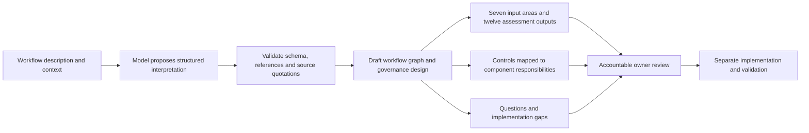

# From a workflow description to a governance design

The designer accepts a natural-language description of a process and uses a configured Ollama model to draft its governance design. It can describe domains beyond the two executable laboratory workflows. Its output is a review artifact: a workflow map, source references, proposed controls, questions, implementation gaps and a mapping to the eighteen component groups.

The [source framework and extension map](framework-extension-map.md) explains how this follows the Erdos input/output model. The [illustrated briefing](Governed_Agent_Fabric_Generalisation.pdf) walks through the original framework, our engineering extensions and the component responsibilities.

## Try a supplied description

Use an Ollama server and an installed model that supports structured JSON output. The endpoint and model are selected by the operator. The supplied examples are synthetic and contain no private business information.

```bash
python -m pip install -e .
python -m fabric.workflow_cli design --description-file examples/workflow-descriptions/vendor-onboarding.txt --model qwen3:8b --thinking --timeout 600 --output results/vendor-design.json --report results/vendor-design.md
python -m fabric.workflow_cli design --description-file examples/workflow-descriptions/museum-loan.txt --model qwen3:8b --thinking --timeout 600 --output results/museum-design.json --report results/museum-design.md
```

You can pass a short description with `--description` instead. Descriptions are bounded to 12,000 characters. `--ollama-url` selects another model service, and `--timeout` configures the design budget shared by generation and a possible correction attempt (maximum setting 600 seconds). The description is sent to that configured service; the default is the local loopback endpoint. Put the process, its exceptions, affected people, actual permissions, policies and available evidence into the description. The prompt asks the model to leave unspecified information unresolved. Reviewers must check this: mechanical validation cannot prove that every interpretation or proposed authority follows from the source.

The deadline is checked between response chunks and before each request. HTTP operations use the remaining request-start budget as their timeout; an in-flight read can extend beyond the overall deadline. This is not hard wall-clock cancellation. Deployments needing that guarantee must add an external worker deadline.

## What happens to the description



The model receives the workflow as untrusted source material, with a strict output schema. Structural validation rejects unexpected fields, invalid relationships and invented evidence quotations. Entity categories use separate identifier prefixes to prevent ambiguous references. A bounded correction attempt can repair a malformed draft; it receives the rejected draft as untrusted data only when the complete draft fits the repair size limit. Exhausted attempts fail without writing a success artifact. The designer has no execution tools, target credentials or deployment approval operation.

The provider integration uses Ollama's [structured-output API](https://docs.ollama.com/capabilities/structured-outputs) with independent validation of the response. Models and endpoints must support that API contract; a valid JSON shape alone does not establish a correct governance judgement. Local generation can take several minutes, depending on the model and hardware; the examples allow ten minutes for generation and a possible correction. The CLI's default budget is three minutes.

The examples use `--thinking` to request the selected model's reasoning mode, matching the latest recorded local observations. The request uses a larger generation-token budget within the same time and response-size limits, and records this setting in provenance. Optional provider reasoning text is bounded and excluded from the design, report, correction prompt and logs. Model capabilities and chat-template configuration affect generation quality; choosing a model is part of configuring the designer. These observations are not a controlled comparison of reasoning modes.

Source quotations prove that text occurs in the supplied description. They do not establish that the description is true, that the model has interpreted it correctly, or that a described control operates in production. Owners must review the interpretation and supply independent evidence.

## Inspect the outputs

The JSON is the complete machine-readable design. The Markdown report presents the draft for review. Both preserve the distinction between supplied information and proposed design decisions.

| Output | How to use it |
| --- | --- |
| Source text, digest and quotation references | Trace the draft back to the exact supplied description. |
| Actors, data, tools, steps, decisions and transitions | Correct the model's interpretation of the process and its handoffs. |
| Risks and proposed controls | Review concrete failure scenarios and their suggested prevention, detection and response. |
| Gaps, questions and human authority | Assign missing decisions to accountable people. |
| Framework output mapping | Inspect the original twelve assessment areas in one structured record. |
| Component responsibilities | Identify which shared capabilities could implement each control. |
| Readiness and implementation gaps | Separate a governance proposal from operational approval and implementation evidence. |

The generated design always requires review and does not grant production readiness. It is a concise initial assessment, explicitly marked non-exhaustive; reviewers must identify omitted risks, process detail and exception paths. Component suggestions express an implementation mapping, not proof that a product is installed or that its controls are effective. Legal applicability, risk ratings, business benefits and actual permissions require authoritative evidence and owner judgement.

## Connect a reviewed design to execution

Natural-language design and runtime configuration have different contracts. The designer does not silently translate a hypothetical purchasing action into the synthetic credit adapter, or treat a museum loan as an IT permission grant.

After review, express supported controls in the [workflow configuration contract](configurable-workflows.md). Register a reviewed adapter for each business effect, connect authoritative sources, configure identities and native bindings, and validate positive and negative journeys. Use the existing `package` command to create a disabled deployment manifest for independent approval. Remote targets additionally need durable delivery, target idempotency and reconciliation.

The interpretation graph may describe branches, parallel work and exceptions. It is a design graph; the current runtime is a bounded operation engine and does not execute arbitrary graph structures. A new workflow can reuse existing capabilities through configuration; new effects or new control mechanisms require explicit implementation.

## Verification

Automated designer tests use simulated model responses to check contract validation, provenance, reference integrity, transport handling and the absence of execution authority. They do not establish that a live model reliably identifies every governance issue.

The [recorded native observations](validation.md#native-designer-observations-2026-11-02) include a structurally accepted vendor draft that still needs substantive revision and a museum example rejected after correction. This is a review-assisted prototype; successful generation and faithful interpretation are separate checks.

For a real local-model observation, run:

```bash
python scripts/run_workflow_designer.py --model qwen3:8b --thinking --timeout 600 --description examples/workflow-descriptions/vendor-onboarding.txt --description examples/workflow-descriptions/museum-loan.txt --output-dir results/workflow-designer/my-run
```

The recorder preserves each design, its report, source and implementation digests, observed model identity and run outcome. It also accepts `--thinking`. Add `--capture-model-responses` to preserve complete provider responses for diagnosis; these files include generated content derived from the supplied description and any provider reasoning trace. An example that passes structural checks still needs substantive review. It is not evidence of universal domain coverage, legal adequacy or full eighteen-product deployment acceptance.
