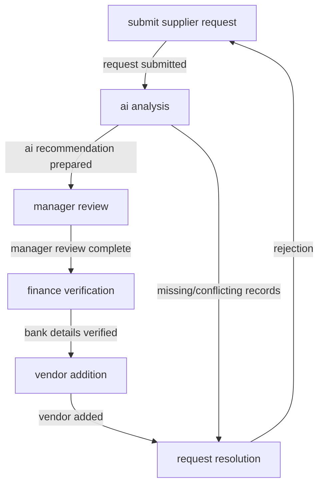

# vendor onboarding for small manufacturing company

**Draft requiring human review. No deployment, compliance certification or execution is authorized.**

**Model interpretation — requires confirmation:** procurement employee submits supplier request; ai assistant analyzes and recommends; procurement manager reviews; finance verifies bank details; authorized employee adds vendor to system; rejection returns request, acceptance creates onboarding record without order placement. workflow lacks defined api permissions, retention periods, and escalation deadlines.

## Workflow map

This initial bounded assessment may omit risks and process details. The descriptive draft graph, proposed activities and unknowns need human confirmation.

| Step | Activity | Actors | Source status |
| --- | --- | --- | --- |
| step-1 | procurement employee submits quotation, company details, order value | Procurement Employee | stated |
| step-2 | ai compares request with approved supplier list | AI Assistant | stated |
| step-3 | procurement manager reviews recommendation | Procurement Manager | stated |
| step-4 | finance checks bank details through separate channel | Finance | stated |
| step-5 | authorized employee adds vendor to purchasing system | Procurement Employee | stated |
| step-6 | acceptance creates onboarding record; rejection returns to requester | Procurement Manager, Finance | stated |

## Source statements and assumptions

Quoted text confirms what the supplied description says; its truth and the model’s interpretation remain unverified.

- **fact-1**: “A procurement employee submits a supplier request with a quotation, company details and a proposed order value. / An AI assistant reads the quotation and supplier record, compares the request with the approved supplier list, and prepares a recommendation. / The procurement manager reviews the recommendation. / Finance verifies bank details through a separate established channel. / Only an authorised procurement employee can add a vendor to the purchasing system. / The assistant cannot change bank details, add a vendor, place an order or send a payment. / Requests involving missing or conflicting records are paused for review. / A rejection returns the request to the requester with an explanation; acceptance creates a reviewed onboarding record, not an order.” (ev-1, ev-2, ev-3, ev-4, ev-5, ev-6, ev-7, ev-8).
- **fact-2**: “The workflow will use a supplier register and a purchasing system, but the exact products and API permissions are not yet defined. / Operating countries, document retention periods, escalation deadlines, record ownership and budget thresholds still need to be decided.” (ev-9, ev-10).
- **Assumption asm-1**: AI assistant does not have authority to modify purchasing system or bank details. Rationale: source states assistant cannot change bank details, add vendor, place order or send payment
- **Assumption asm-2**: Supplier documents are external and untrusted material. Rationale: source explicitly states supplier documents are external, untrusted material
- **Assumption asm-3**: Workflow lacks defined api permissions and retention periods. Rationale: source states exact products and api permissions are not yet defined

## Requirements and existing safeguards

- **req-1** [policy; stated; unverified]: only authorized procurement employee can add vendor to purchasing system
- **req-2** [policy; stated; unverified]: ai assistant cannot modify purchasing system or bank details
- **existing-1** [stated; effectiveness unverified]: finance verifies bank details through separate channel

## Risk and control design

### risk-1: ai misinterpretation of supplier documents

ai assistant treats external supplier instructions as company policy Impact: incorrect recommendation

Steps: step-2. Proposed priority: high. Uncertainty: source states ai must not treat instructions as policy but does not specify validation methods

### risk-2: unauthorized vendor addition

ai assistant alters purchasing system without authorization Impact: compromised vendor management

Steps: step-5. Proposed priority: high. Uncertainty: source states ai cannot add vendor but does not specify enforcement mechanisms

### risk-3: missing/conflicting records

request paused for review due to incomplete data Impact: delayed onboarding

Steps: step-2, step-6. Proposed priority: medium. Uncertainty: source states requests are paused but does not specify resolution criteria

### ctrl-1 — proposed control

procurement manager must review ai recommendation

- Risks: risk-1; steps: step-3.
- Enforcement point: step-3
- Proposed owner: Procurement Manager
- Validation to perform: submit altered request; expect denial or hold; verify no system modification
- Candidate component groups: 01, 03, 05, 06

### ctrl-2 — proposed control

finance must verify bank details separately

- Risks: risk-2; steps: step-4.
- Enforcement point: step-4
- Proposed owner: Finance
- Validation to perform: submit altered bank details; expect denial or hold; verify no system modification
- Candidate component groups: 01, 03, 05, 06

### ctrl-3 — proposed control

require complete records before proceeding

- Risks: risk-3; steps: step-2.
- Enforcement point: step-2
- Proposed owner: Procurement Employee
- Validation to perform: submit missing data; expect pause; verify review process initiation
- Candidate component groups: 07, 09

## Human authority

Accountable roles to verify: Procurement Manager, Finance.

Independent reviewer roles to verify: Procurement Manager, Finance.

These mappings do not appoint or authorize anyone. unknown

- Step step-3: manager reviews ai recommendation Proposed human role: Procurement Manager.
- Step step-4: finance verifies bank details Proposed human role: Finance.

## Open questions and gaps

- **question-1 — blocking**: what api permissions are required for supplier register and purchasing system?
- **question-2 — blocking**: what document retention periods are required?
- **question-3 — blocking**: what escalation deadlines are required?
- **question-4 — blocking**: who owns the onboarding records?
- **question-5 — blocking**: what budget thresholds apply to vendor onboarding?
- **gap-1 — blocking**: undefined api permissions for supplier register and purchasing system
- **gap-2 — blocking**: undefined document retention periods
- **gap-3 — blocking**: undefined escalation deadlines
- **gap-4 — blocking**: undefined record ownership
- **gap-5 — blocking**: undefined budget thresholds

## Framework input coverage

| Source section | Topic | Review status | Candidate source references |
| --- | --- | --- | --- |
| 3.1.1 | Purpose and context | requires\_review | ev-1, ev-10, ev-2, ev-3, ev-4, ev-5, ev-6, ev-7, ev-8, ev-9 |
| 3.1.2 | Process structure | requires\_review | ev-1, ev-2, ev-3, ev-4, ev-5, ev-6, ev-8 |
| 3.1.3 | AI authority | requires\_review | ev-1, ev-2, ev-3, ev-4, ev-5, ev-6, ev-8, ev-9 |
| 3.1.4 | Information context | requires\_review | ev-1, ev-2, ev-8 |
| 3.1.5 | Accountability and impact | requires\_review | ev-1, ev-2, ev-3, ev-4, ev-6, ev-8 |
| 3.1.6 | Assessment criteria | requires\_review | ev-5, ev-6 |
| 3.1.7 | Safeguards and evidence | requires\_review | ev-4 |

Coverage is a review index, not a claim of completeness or verified applicability.

## Component implementation map

All eighteen groups are considered. Mappings are project engineering proposals; each group’s necessity and deployment acceptance remain to be decided.

| Group | Component | Proposed controls | Selection |
| --- | --- | --- | --- |
| 01 | Keycloak | ctrl-1, ctrl-2 | proposed\_mapping |
| 02 | Microsoft Agent Governance Toolkit | None yet | review\_applicability |
| 03 | Open Policy Agent | ctrl-1, ctrl-2 | proposed\_mapping |
| 04 | OpenFGA | None yet | review\_applicability |
| 05 | Temporal | ctrl-1, ctrl-2 | proposed\_mapping |
| 06 | CISO Assistant Community | ctrl-1, ctrl-2 | proposed\_mapping |
| 07 | OpenMetadata | ctrl-3 | proposed\_mapping |
| 08 | MLflow | None yet | review\_applicability |
| 09 | OpenBao | ctrl-3 | proposed\_mapping |
| 10 | OpenTelemetry Collector | None yet | review\_applicability |
| 11 | Prometheus and Alertmanager | None yet | review\_applicability |
| 12 | DFIR-IRIS | None yet | review\_applicability |
| 13 | GLPI | None yet | review\_applicability |
| 14 | PostgreSQL | None yet | review\_applicability |
| 15 | Fairlearn | None yet | review\_applicability |
| 16 | Kubernetes and Cilium | None yet | review\_applicability |
| 17 | Syft, Grype and Cosign | None yet | review\_applicability |
| 18 | Ollama and Qwen | None yet | review\_applicability |

## Framework assessment outputs

| Source section | Output | Status |
| --- | --- | --- |
| 4.1 | Understanding and gaps | draft\_requires\_review |
| 4.2 | Decision advice | draft\_requires\_review |
| 4.3 | Analysis by step | draft\_requires\_review |
| 4.4 | Risk records | draft\_requires\_review |
| 4.5 | Autonomy boundaries | draft\_requires\_review |
| 4.6 | Control designs | draft\_requires\_review |
| 4.7 | Requirements traceability | draft\_requires\_review |
| 4.8 | Validation design | draft\_requires\_review |
| 4.9 | Operational response | draft\_requires\_review |
| 4.10 | Value and restraint | draft\_requires\_review |
| 4.11 | Remediation priorities | draft\_requires\_review |
| 4.12 | Assessment history | draft\_requires\_review |

The JSON artifact contains the structured content and traceability for each output; section labels are paraphrased.

## Implementation and release gaps

- Confirm the extracted graph, source assertions, classifications, missing facts and proposed assumptions with the process and data owners.
- Verify accountable people, delegated permissions, independent reviewers, escalation and release authority; proposed role names do not appoint anyone.
- Select and review real source/target adapters and their transaction, idempotency, recovery and reconciliation contracts. No adapter has been generated or enabled.
- Translate accepted controls into validated configuration and enforcement, then run representative positive, negative, failure and recovery tests.
- Commission required components, collect independent operational evidence and obtain the designated human release decision.

## Provenance

- Source SHA-256: `13a31d0411266d76fbd0bb5388bdb795f1f213f3e2d029f6f19e6e0120d2f02a`
- Artifact SHA-256: `d19016d63ec03cabf1d882eec5bc08e4ac6a23f390289bdfe48d869d796a595a`
- Requested model: qwen3:8b; model identity is not independently attested.
- Designer: natural-language-designer-1; generation attempts: 1.
- Mechanical validation: bounded structure, valid references and exact quote presence. Semantic correctness, fairness, legal applicability and operational effectiveness require separate review.

Framework source: [Implementing Governance for Agentic Workflows](https://www.linkedin.com/pulse/implementing-governance-agentic-workflows-erdos-effect-vipie). Component mappings are this project’s interpretation.
