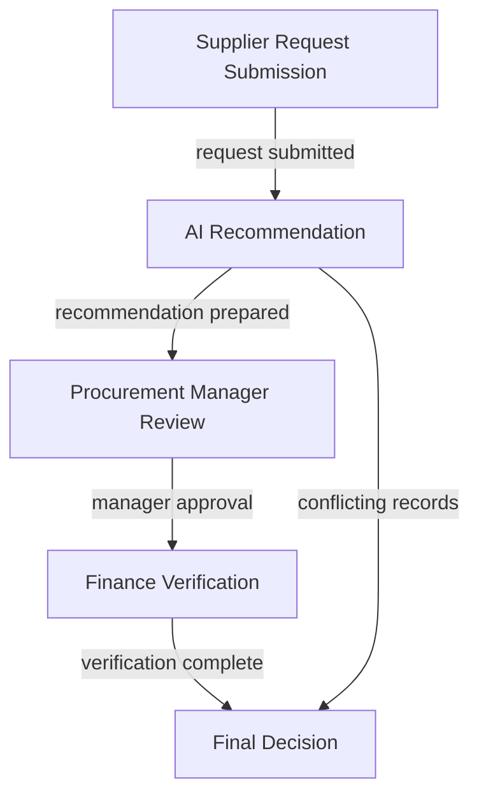

# vendor onboarding for small manufacturing company

**Draft requiring human review. No deployment, compliance certification or execution is authorized.**

**Model interpretation — requires confirmation:** procurement employee submits supplier request; ai assistant reviews against approved list; procurement manager and finance verify details; final decision creates onboarding record without order placement

## Workflow map

This initial bounded assessment may omit risks and process details. The descriptive draft graph, proposed activities and unknowns need human confirmation.

| Step | Activity | Actors | Source status |
| --- | --- | --- | --- |
| step-1 | Procurement employee submits request with quotation and details | Procurement Employee | stated |
| step-2 | AI compares request with approved list and prepares recommendation | AI Assistant | stated |
| step-3 | Manager reviews AI recommendation for approval | Procurement Manager | stated |
| step-4 | Finance checks bank details through established channel | Finance | stated |
| step-5 | Acceptance creates onboarding record; rejection returns request | Procurement Employee | stated |

## Source statements and assumptions

Quoted text confirms what the supplied description says; its truth and the model’s interpretation remain unverified.

- **fact-1**: “A procurement employee submits a supplier request with a quotation, company details and a proposed order value. / An AI assistant reads the quotation and supplier record, compares the request with the approved supplier list, and prepares a recommendation. / The procurement manager reviews the recommendation. / Finance verifies bank details through a separate established channel. / Only an authorised procurement employee can add a vendor to the purchasing system. / Requests involving missing or conflicting records are paused for review. / The expected benefit is less time spent preparing each review.” (ev-1, ev-2, ev-3, ev-4, ev-5, ev-6, ev-7).
- **fact-2**: “An AI assistant reads the quotation and supplier record, compares the request with the approved supplier list, and prepares a recommendation. / Only an authorised procurement employee can add a vendor to the purchasing system.” (ev-2, ev-5).
- **Assumption asm-1**: AI assistant's comparison of supplier records with approved list is accurate and complete. Rationale: ev-2
- **Assumption asm-2**: Procurement manager's review is sufficient to validate recommendation. Rationale: ev-3

## Requirements and existing safeguards

- **req-1** [policy; stated; unverified]: Procurement employee must submit complete supplier request
- **req-2** [policy; stated; unverified]: AI assistant must compare against approved supplier list
- **existing-1** [stated; effectiveness unverified]: AI assistant cannot modify vendor records or place orders
- **existing-2** [stated; effectiveness unverified]: Only authorised procurement employee can add vendor

## Risk and control design

### risk-1: AI Misclassification

AI incorrectly recommends unapproved supplier Impact: Potential vendor fraud

Steps: step-2. Proposed priority: high. Uncertainty: asm-1

### risk-2: Manager Oversight

Procurement manager approves flawed recommendation Impact: Invalid vendor onboarding

Steps: step-3. Proposed priority: medium. Uncertainty: asm-2

### risk-3: Finance Verification Failure

Bank details not verified properly Impact: Payment fraud or failed transactions

Steps: step-4. Proposed priority: high. Uncertainty: unknown

### ctrl-1 — proposed control

AI must validate supplier against approved list

- Risks: risk-1; steps: step-2.
- Enforcement point: step-2
- Proposed owner: Procurement Manager
- Validation to perform: submit altered quotation; expect denial or hold, verify no vendor addition
- Candidate component groups: 07, 09

### ctrl-2 — proposed control

Procurement manager must review AI recommendation

- Risks: risk-2; steps: step-3.
- Enforcement point: step-3
- Proposed owner: Procurement Manager
- Validation to perform: submit conflicting records; expect pause for review
- Candidate component groups: 01, 03, 05, 06

### ctrl-3 — proposed control

Finance must verify bank details through established channel

- Risks: risk-3; steps: step-4.
- Enforcement point: step-4
- Proposed owner: Finance
- Validation to perform: submit altered bank details; expect verification failure
- Candidate component groups: 07, 09

## Human authority

Accountable roles to verify: Procurement Manager, Finance.

Independent reviewer roles to verify: Procurement Manager, Finance.

These mappings do not appoint or authorize anyone. unknown

- Step step-3: manager must approve recommendation Proposed human role: Procurement Manager.
- Step step-4: finance must verify bank details Proposed human role: Finance.

## Open questions and gaps

- **question-1 — blocking**: What are the exact products and API permissions for the purchasing system?
- **question-2 — blocking**: What operating countries and document retention periods are required?
- **question-3 — blocking**: Who will own the onboarding records and what are the budget thresholds?
- **gap-1 — blocking**: Exact products and API permissions for purchasing system are undefined

## Framework input coverage

| Source section | Topic | Review status | Candidate source references |
| --- | --- | --- | --- |
| 3.1.1 | Purpose and context | requires\_review | ev-1, ev-2, ev-3, ev-4, ev-5, ev-6, ev-7 |
| 3.1.2 | Process structure | requires\_review | ev-1, ev-2, ev-3, ev-4, ev-5, ev-6 |
| 3.1.3 | AI authority | requires\_review | ev-1, ev-2, ev-3, ev-4, ev-5 |
| 3.1.4 | Information context | requires\_review | ev-1, ev-2 |
| 3.1.5 | Accountability and impact | requires\_review | ev-1, ev-2, ev-3, ev-4, ev-5 |
| 3.1.6 | Assessment criteria | requires\_review | ev-1, ev-2 |
| 3.1.7 | Safeguards and evidence | requires\_review | ev-2, ev-5 |

Coverage is a review index, not a claim of completeness or verified applicability.

## Component implementation map

All eighteen groups are considered. Mappings are project engineering proposals; each group’s necessity and deployment acceptance remain to be decided.

| Group | Component | Proposed controls | Selection |
| --- | --- | --- | --- |
| 01 | Keycloak | ctrl-2 | proposed\_mapping |
| 02 | Microsoft Agent Governance Toolkit | None yet | review\_applicability |
| 03 | Open Policy Agent | ctrl-2 | proposed\_mapping |
| 04 | OpenFGA | None yet | review\_applicability |
| 05 | Temporal | ctrl-2 | proposed\_mapping |
| 06 | CISO Assistant Community | ctrl-2 | proposed\_mapping |
| 07 | OpenMetadata | ctrl-1, ctrl-3 | proposed\_mapping |
| 08 | MLflow | None yet | review\_applicability |
| 09 | OpenBao | ctrl-1, ctrl-3 | proposed\_mapping |
| 10 | OpenTelemetry Collector | None yet | review\_applicability |
| 11 | Prometheus and Alertmanager | None yet | review\_applicability |
| 12 | DFIR-IRIS | None yet | review\_applicability |
| 13 | GLPI | None yet | review\_applicability |
| 14 | PostgreSQL | None yet | review\_applicability |
| 15 | Fairlearn | None yet | review\_applicability |
| 16 | Kubernetes and Cilium | None yet | review\_applicability |
| 17 | Syft, Grype and Cosign | None yet | review\_applicability |
| 18 | Ollama and Qwen | None yet | review\_applicability |

## Framework assessment outputs

| Source section | Output | Status |
| --- | --- | --- |
| 4.1 | Understanding and gaps | draft\_requires\_review |
| 4.2 | Decision advice | draft\_requires\_review |
| 4.3 | Analysis by step | draft\_requires\_review |
| 4.4 | Risk records | draft\_requires\_review |
| 4.5 | Autonomy boundaries | draft\_requires\_review |
| 4.6 | Control designs | draft\_requires\_review |
| 4.7 | Requirements traceability | draft\_requires\_review |
| 4.8 | Validation design | draft\_requires\_review |
| 4.9 | Operational response | draft\_requires\_review |
| 4.10 | Value and restraint | draft\_requires\_review |
| 4.11 | Remediation priorities | draft\_requires\_review |
| 4.12 | Assessment history | draft\_requires\_review |

The JSON artifact contains the structured content and traceability for each output; section labels are paraphrased.

## Implementation and release gaps

- Confirm the extracted graph, source assertions, classifications, missing facts and proposed assumptions with the process and data owners.
- Verify accountable people, delegated permissions, independent reviewers, escalation and release authority; proposed role names do not appoint anyone.
- Select and review real source/target adapters and their transaction, idempotency, recovery and reconciliation contracts. No adapter has been generated or enabled.
- Translate accepted controls into validated configuration and enforcement, then run representative positive, negative, failure and recovery tests.
- Commission required components, collect independent operational evidence and obtain the designated human release decision.

## Provenance

- Source SHA-256: `13a31d0411266d76fbd0bb5388bdb795f1f213f3e2d029f6f19e6e0120d2f02a`
- Artifact SHA-256: `0cfd0ac7db4bd0959c278ac0f7512f61394f6dbf8f3cfa69025f91fd114e6aa6`
- Requested model: qwen3:8b; model identity is not independently attested.
- Designer: natural-language-designer-1; generation attempts: 2.
- Mechanical validation: bounded structure, valid references and exact quote presence. Semantic correctness, fairness, legal applicability and operational effectiveness require separate review.

Framework source: [Implementing Governance for Agentic Workflows](https://www.linkedin.com/pulse/implementing-governance-agentic-workflows-erdos-effect-vipie). Component mappings are this project’s interpretation.
